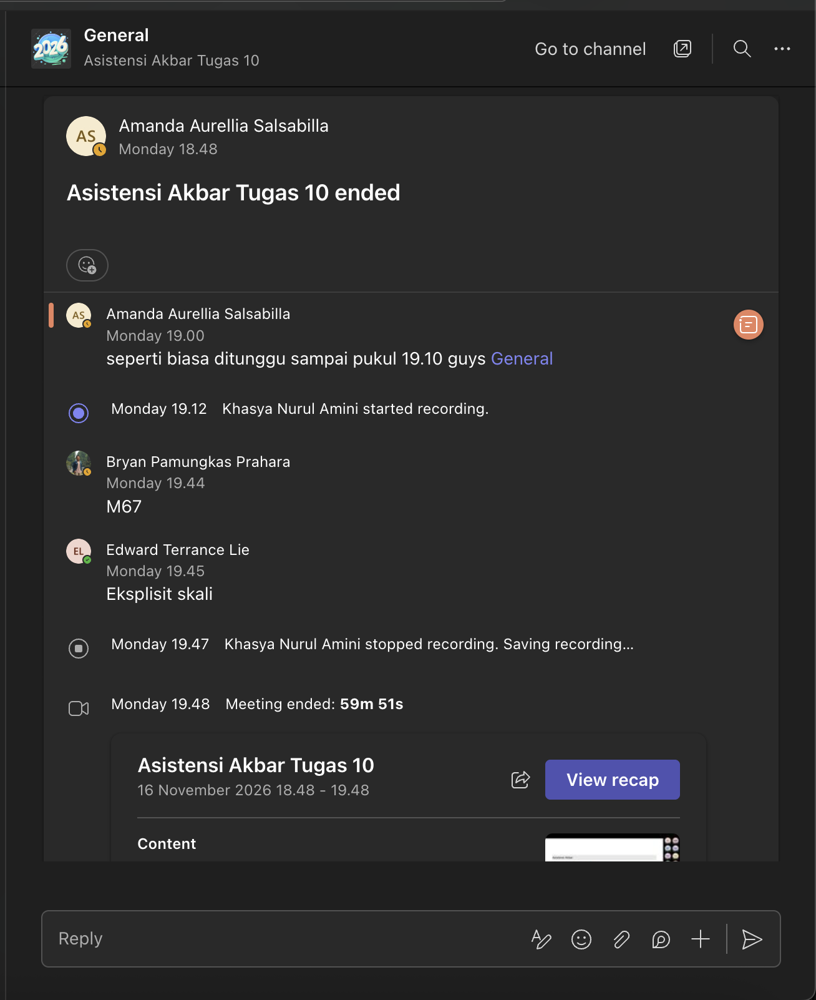

# Form Asistensi

## Tugas Besar IF2150 - Rekayasa Perangkat Lunak

| Informasi | Keterangan |
| --- | --- |
| **Hari** | Senin |
| **Tanggal** | 16/11/2026 |
| **Kelas** | K03 |
| **Nomor Kelompok** | G01 |
| **Nama Kelompok** | rplsukses |
| **Nama Perangkat Lunak** | RekanBumi |
| **Dokumen** | M10 (Hasil Implementasi dan Uji Perangkat Lunak) |

### Anggota Kelompok

| NIM | Nama |
| --- | --- |
| 13525018 | Avicenna Ananda Musthafa |
| 13525045 | Ribka Kaylena Sanjaya |
| 13525063 | Kairenzo Vemil |
| 13525069 | Mulky Siraj Firizqi |
| 13525144 | Three Gie Gendhis Sekar Ayoe Jatmiko |

### Catatan

| Catatan |
| --- |
| 1. Asistensi dilakukan secara daring melalui Microsoft Teams dalam bentuk asistensi akbar Tugas 10 (Hasil Implementasi dan Uji Perangkat Lunak, HIUPL), pukul 18.48 sampai 19.48 WIB. |
| 2. Pengumpulan draft pada 16/11/2026 pukul 21.00 WIB dan final pada 20/11/2026 pukul 21.00 WIB. Pengujian dilakukan pada kode di release tag terakhir Milestone 9 (`v9.0`). |
| 3. Pengujian unit ditentukan per kelas dengan tiga tingkat. Mendalam: setiap operasi public memiliki minimal 3 test case (normal, batas, dan negatif) dengan *coverage* minimal 70% yang dilaporkan per kelas sebagai % baris dan % cabang. Sedang: operasi utama memiliki minimal 2 test case (normal dan negatif) dan boleh teruji lewat integration test. Tidak perlu: alasannya dituliskan pada Tabel 4.1.1. |
| 4. Unit test dan integration test dijalankan otomatis. Use case dan sebagian KNF diuji manual dengan tangkapan layar. Integration test memakai komponen asli tanpa *mock*, dan setiap *interface* pada *view* arsitektur DPPL memiliki minimal satu test case. |
| 5. Setiap KNF yang diuji memuat target, metode atau alat ukur, jumlah pengulangan, dan angka hasil pengukuran aktual. |
| 6. Bukti dilampirkan untuk setiap test case. Unit test berupa keluaran *test runner* (satu gambar per kelas diperbolehkan) beserta laporan *coverage*. Integration test berupa keluaran *test runner*, basis data, atau *log*. KNF berupa tangkapan layar alat ukur. |
| 7. Pada BAB 5, sebuah KF dinyatakan terpenuhi hanya jika seluruh test case terkaitnya berkesimpulan `Pass`. Seluruh *testing tools* yang dipakai dicantumkan pada Subbab 3.1. |

## Dokumentasi

<!--  -->

  

  <i>Gambar 1. Dokumentasi asistensi akbar Tugas 10 (Microsoft Teams).</i>

