<h1>
IF2150 REKAYASA PERANGKAT LUNAK
 
TUGAS 7
 
DESKRIPSI PERANCANGAN PERANGKAT LUNAK (DPPL)
</h1>
 

## RekanBumi

### Untuk: Stefani Angeline Oroh

Dipersiapkan oleh:
| Informasi | Keterangan |
| --- | --- |
| Kelas | K03 |
| Kelompok | G01 |

| NIM | Nama |
|---|---|
| 13525018 | Avicenna Ananda Musthafa |
| 13525045 | Ribka Kaylena Sanjaya |
| 13525063 | Kairenzo Vemil |
| 13525069 | Mulky Siraj Firizqi |
| 13525144 | Three Gie Gendhis Sekar Ayoe Jatmiko |
---

## Daftar Perubahan

<!-- Revisi yang dilakukan pada dokumen sebelumnya dicatat di dokumen masing-masing SKPL revisi D dan APL revisi A atau di dokumen ini? -->

| Revisi | Deskripsi |
| :--- | :--- |
|  |  |

---

 

# BAB 1: Pendahuluan

## 1.1 Tujuan Penulisan Dokumen
Dokumen Deskripsi Perancangan Perangkat Lunak (DPPL) ini disusun untuk menjabarkan rancangan perangkat lunak RekanBumi sebagai kelanjutan dari dokumen Spesifikasi Kebutuhan Perangkat Lunak (SKPL) dan Arsitektur Perangkat Lunak (APL). Dokumen ini menerjemahkan kebutuhan, *use case*, dan kelas analisis yang telah didefinisikan pada SKPL, serta arsitektur yang telah ditetapkan pada APL, menjadi rancangan yang siap diimplementasikan, meliputi rancangan lingkungan implementasi, rancangan arsitektur, realisasi setiap *use case* dalam bentuk *sequence diagram* dan diagram kelas, diagram kelas perancangan keseluruhan, serta matriks kerunutan antara kelas perancangan dan *use case*.

Dokumen ini ditujukan untuk beberapa pihak, yaitu:

1. Tim pengembang (*developer*) RekanBumi, sebagai acuan utama dalam tahap implementasi kode program agar struktur kelas, interaksi antarkomponen, dan alur proses yang dibangun sesuai dengan rancangan yang telah disepakati.
2. Asisten dan dosen mata kuliah IF2150 Rekayasa Perangkat Lunak, sebagai bahan evaluasi terhadap kesesuaian dan konsistensi rancangan perangkat lunak dengan dokumen SKPL dan APL yang telah disusun sebelumnya.
3. Pihak yang melakukan pengujian dan pemeliharaan perangkat lunak, sebagai rujukan untuk menelusuri keterkaitan antara kelas perancangan dan *use case* yang direalisasikan.

## 1.2 Lingkup Masalah
RekanBumi adalah suatu web terintegrasi yang berperan sebagai perantara atau penghubung antara masyarakat umum yang berperan sebagai relawan dengan program-program ramah lingkungan yang disediakan oleh lembaga-lembaga yang tersebar di seluruh Indonesia. Web ini dikembangkan atas dasar *awareness* dalam mewujudkan aksi nyata dalam menjaga iklim dan ekosistem darat yang tercantum pada SDG 13 dan SDG 15. RekanBumi diharapkan dapat mempersempit kesenjangan antara besarnya potensi partisipasi masyarakat dengan minimnya sarana yang menghubungkan mereka dengan lembaga-lembaga lingkungan yang membutuhkan dukungan.

## 1.3 Definisi, Istilah, dan Singkatan

Tabel 1.3. Definisi Istilah dan Singkatan

| Singkatan, Akronim, atau Istilah | Penjelasan |
| :--- | :--- |
| P/L | Singkatan dari Perangkat Lunak, yaitu aplikasi yang memberikan perintah kepada komputer untuk menjalankan tugas tertentu. |
| DPPL | Singkatan dari Deskripsi Perancangan Perangkat Lunak, yaitu dokumen yang menjabarkan rancangan arsitektur, realisasi *use case*, dan rancangan kelas perangkat lunak sebagai acuan implementasi. |
| SKPL | Singkatan dari Spesifikasi Kebutuhan Perangkat Lunak, yaitu dokumen yang merangkum kriteria-kriteria yang diperlukan untuk membangun aplikasi menjalankan tugasnya. |
| APL | Singkatan dari Arsitektur Perangkat Lunak, yaitu dokumen yang mendefinisikan *style/pattern* arsitektur, komponen penyusun, dan model arsitektur perangkat lunak. |
| KF | Singkatan dari Kebutuhan Fungsional. |
| KNF | Singkatan dari Kebutuhan Non-Fungsional. |
| UC | Singkatan dari *Use Case*. |
| SDG | Singkatan dari *Sustainable Development Goals* atau Tujuan Pembangunan Berkelanjutan berupa 17 tujuan yang disepakati PBB untuk mencapai perdamaian dan kemakmuran manusia dan bumi tahun 2030. |
| MVC | Singkatan dari *Model-View-Controller*, yaitu pola arsitektur yang memisahkan tanggung jawab antara representasi data (*Model*), antarmuka pengguna (*View*), dan pengendalian alur proses (*Controller*). |
| *Client-Server* | Gaya arsitektur yang membagi perangkat lunak menjadi *client* yang berinteraksi langsung dengan pengguna dan *server* yang menjalankan proses bisnis serta mengelola data. |
| *Boundary Class* | Kelas yang menyediakan antarmuka interaksi antara pengguna dan sistem; dipetakan ke komponen *View* pada MVC. |
| *Controller Class* | Kelas yang mengendalikan alur proses dan validasi; dipetakan ke komponen *Controller* pada MVC. |
| *Entity Class* | Kelas yang merepresentasikan dan menyimpan data domain sistem; dipetakan ke komponen *Model* pada MVC. |
| *Logical View* | *Architectural view* yang menggambarkan abstraksi utama perangkat lunak beserta hubungan antarkomponennya. |
| *Physical View* | *Architectural view* yang menggambarkan distribusi komponen perangkat lunak pada *node* fisik/komputasi beserta komunikasi antar-*node*. |
| *Sequence Diagram* | Diagram UML yang menggambarkan urutan interaksi (pemanggilan operasi) antarobjek dalam menjalankan suatu skenario *use case*. |
| Visibilitas | Tingkat akses atribut atau operasi pada diagram kelas: `+` *public*, `-` *private*, dan `#` *protected*. |
| Multiplisitas | Jumlah objek yang dapat terlibat pada satu sisi relasi antarkelas, misalnya `1`, `0..1`, atau `0..*`. |
| Enumerasi | Tipe data dengan himpunan nilai yang tetap, misalnya status program atau kategori program. |
| DBMS | Singkatan dari *Database Management System*, yaitu perangkat lunak pengelola basis data. |
| ORM | Singkatan dari *Object-Relational Mapping*, yaitu teknik/pustaka yang menjembatani objek pada aplikasi dengan tabel pada basis data relasional (pada RekanBumi menggunakan Prisma). |
| API | Singkatan dari *Application Programming Interface*, yaitu antarmuka yang digunakan antarkomponen perangkat lunak untuk saling berkomunikasi. |
| tRPC | Pustaka yang digunakan sebagai mekanisme komunikasi antara *client* dan *server* untuk mengakses fungsi aplikasi. |
| Inisiator Program | Lembaga atau komunitas lingkungan yang mendaftarkan diri dan programnya pada web RekanBumi, lalu mengelola program, seleksi relawan, dan laporan kegiatan. |
| Relawan | Masyarakat umum yang memiliki akun pribadi di RekanBumi dan mendaftar, mengikuti, atau berkontribusi pada setidaknya satu program. |
| Verifikator | Admin platform RekanBumi yang memverifikasi identitas dan legalitas Inisiator Program serta meninjau kelayakan program dan laporan akhir sebelum dipublikasikan. |
| Program | Kegiatan ramah lingkungan yang diinisiasi oleh Inisiator Program dan terdaftar pada web RekanBumi, merupakan setidaknya salah satu dari dua kategori 'Jaga Alam' dan 'Jaga Iklim'. |
| Jaga Alam | Kategori program yang tersedia pada web RekanBumi yang meliputi program-program penjagaan kebersihan lingkungan dan kesejahteraan hewan liar. |
| Jaga Iklim | Kategori program yang tersedia pada web RekanBumi yang meliputi program-program penanaman pohon. |

## 1.4 Aturan Penomoran
Penomoran identifikasi (ID) pada dokumen DPPL ini menggunakan pola yang sama dengan dokumen SKPL dan APL untuk menjaga konsistensi dan kemudahan penelusuran (*traceability*). Kelas baru yang muncul pada tahap perancangan melanjutkan nomor kelas terakhir pada SKPL. Nomor gambar dan tabel mengikuti nomor bab (misalnya Gambar 2.1 dan Tabel 4.1).

Tabel 1.4. Aturan Penomoran

| Hal/Bagian | Penomoran | Keterangan |
| :--- | :--- | :--- |
| Kebutuhan Fungsional | KFXX | Identifikasi unik untuk setiap fungsi dan respons utama perangkat lunak (KF01–KF16). |
| Kebutuhan Non-Fungsional | KNFXX | Identifikasi unik untuk batasan kualitas, performa, dan keandalan sistem (KNF01–KNF08). |
| Aktor | AXX | Identifikasi entitas pengguna atau peran yang berinteraksi dengan sistem (A01–A03). |
| Use Case | UCXX | Identifikasi unit interaksi fungsional antara aktor dan perangkat lunak (UC01–UC09). |
| Kelas | CXX | Identifikasi kelas pada pemodelan berorientasi objek (C01–C20 dari SKPL; C21–C22 ditambahkan pada tahap perancangan). |

## 1.5 Referensi
1. Kelompok G01 K03. (2026). *Spesifikasi Kebutuhan Perangkat Lunak (SKPL) RekanBumi*, revisi D. IF2150 Rekayasa Perangkat Lunak, Institut Teknologi Bandung.
2. Kelompok G01 K03. (2026). *Arsitektur Perangkat Lunak (APL) RekanBumi*, revisi A. IF2150 Rekayasa Perangkat Lunak, Institut Teknologi Bandung.
3. Sommerville, I. (2016). *Software Engineering* (10th ed.). Pearson. Chapter 6: *Architectural Design*. https://software-engineering-book.com/slides/
4. Next.js Documentation. https://nextjs.org/docs
5. Tailwind CSS Documentation. https://tailwindcss.com/docs
6. Prisma Documentation. https://www.prisma.io/docs
7. tRPC Documentation. https://trpc.io/docs
8. Better Auth Documentation. https://www.better-auth.com/docs
9. Neon Documentation. https://neon.tech/docs
10. Diagram UML: https://www.drawio.com/, https://staruml.io/, https://plantuml.com/

## 1.6 Deskripsi Umum Dokumen (Ikhtisar)
Dokumen ini terdiri atas lima bab. BAB 1 Pendahuluan berisi tujuan penulisan dokumen, lingkup masalah, definisi istilah dan singkatan, aturan penomoran, referensi, serta ikhtisar dokumen. BAB 2 Perancangan Arsitektur berisi rancangan lingkungan implementasi, *style/pattern* arsitektur acuan (*Client-Server* dan MVC) beserta alasan pemilihannya, identifikasi komponen/modul/subsistem, serta model arsitektur dalam bentuk *Logical View* dan *Physical View*. BAB 3 Realisasi *Use Case* berisi identifikasi kelas perancangan, *sequence diagram* untuk setiap skenario, dan diagram kelas untuk masing-masing *use case* UC01–UC09. BAB 4 Diagram Kelas Keseluruhan berisi diagram kelas perancangan yang menggabungkan seluruh kelas beserta daftar atribut dan metode/operasinya, relasi antarkelas, tipe enumerasi, serta penyesuaian dari kelas analisis pada SKPL. BAB 5 Matriks Kerunutan berisi pemetaan setiap kelas perancangan terhadap *use case* yang direalisasikannya.

 

---

# BAB 2: Perancangan Arsitektur

## 2.1 Rancangan Lingkungan Implementasi

Lingkungan implementasi perangkat lunak RekanBumi mengacu pada lingkungan operasi yang telah ditetapkan pada SKPL (Bab 2.5) dan APL (Bab 1.3), sebagaimana disajikan pada Tabel 2.1.

Tabel 2.1. Rancangan Lingkungan Implementasi

| Komponen | Spesifikasi |
| :--- | :--- |
| *Operating System* | Cross-platform melalui web browser pada perangkat desktop dan mobile |
| *Client* | Web browser modern pada perangkat desktop dan mobile (Google Chrome, Microsoft Edge, Mozilla Firefox, dan Apple Safari) |
| *Server* | Node.js 20+ |
| DBMS | Neon PostgreSQL |
| *Frontend* | Next.js 15 dan Tailwind CSS |
| *Authentication* | Better Auth |
| ORM | Prisma |
| API | tRPC |
| *Filing System* | Layanan penyimpanan berkas berbasis *cloud* (*Cloud File Storage*) yang diakses melalui *CloudStorageAdapter* untuk menyimpan dokumen legalitas lembaga dan foto dokumentasi akhir kegiatan. **[nama layanan cloud storage yang dipakai (belum)]** |
| Bahasa Pemrograman | **[bahasa pemrograman yang digunakan (belum)]** |
| *Development Tools* | **[IDE/editor, version control, tools diagram, dll (belum)]** |

Teknologi yang digunakan mendukung penerapan *Client-Server Architecture* dan MVC. Next.js 15 dan Tailwind CSS digunakan pada sisi *frontend* sebagai bagian yang menyediakan antarmuka kepada *client*. Node.js 20+ menjadi lingkungan *server* untuk menjalankan aplikasi. tRPC digunakan sebagai mekanisme komunikasi antara *client* dan *server* untuk mengakses fungsi aplikasi.

Pada sisi pengelolaan data, Prisma berperan sebagai ORM yang menjembatani aplikasi dengan Neon PostgreSQL sebagai DBMS. Dengan demikian, data yang dikelola oleh *Model* dapat disimpan secara terpusat pada *server*. Better Auth digunakan untuk mendukung kebutuhan autentikasi pengguna pada aplikasi.

## 2.2 Style/Pattern Arsitektur Acuan

Arsitektur perangkat lunak RekanBumi menggunakan *Client-Server Architecture* sebagai gaya arsitektur dan *Model-View-Controller* (MVC) sebagai pola arsitektur pada *interface*. Kombinasi ini digunakan untuk memisahkan interaksi pengguna dengan proses pengolahan data yang dilakukan oleh *server*.

### 2.2.1 Client-Server Architecture

Pada *Client-Server*, perangkat lunak dibagi menjadi dua bagian utama, yaitu *client* dan *server*. *Client* merupakan bagian yang berinteraksi langsung dengan pengguna dan mengirimkan permintaan kepada *server*. *Server* bertanggung jawab menerima permintaan, menjalankan proses bisnis, mengelola data, serta mengirimkan hasil pengolahan kepada *client*.

Jika diimplementasikan pada RekanBumi:
1. *Client* merupakan antarmuka web yang digunakan oleh Relawan, Inisiator Program, dan Verifikator untuk mengakses fungsi-fungsi RekanBumi.
2. *Server* menangani proses aplikasi, autentikasi, pengolahan data, validasi, serta komunikasi dengan basis data.
3. *Database* menyimpan data sistem secara terpusat sehingga data program, pengguna, pendaftaran, kehadiran, laporan, notifikasi, dan riwayat kontribusi dapat digunakan oleh berbagai *client*.

Pemisahan tersebut memungkinkan beberapa jenis pengguna mengakses layanan dan data yang sama melalui *client* masing-masing.

<i>Gambar 2.1. Arsitektur Client-Server RekanBumi</i>

### 2.2.2 Model-View-Controller (MVC)

Di dalam RekanBumi, pola MVC digunakan untuk memisahkan tanggung jawab antara antarmuka pengguna, pengendalian alur proses, dan representasi data.

1. ***Model*** bertanggung jawab merepresentasikan dan mengelola data serta keadaan (*state*) yang digunakan oleh sistem. Pada RekanBumi, bagian *Model* direpresentasikan oleh kelas-kelas *Entity Class*, yaitu Program, Pendaftaran, Relawan, Pengguna, InisiatorProgram, Verifikator, DokumenVerifikasi, Kehadiran, LaporanProgram, Notifikasi, dan RiwayatKontribusi. Misalnya, Program menyimpan informasi program, Pendaftaran menyimpan data pendaftaran relawan, Kehadiran menyimpan catatan *check-in*, dan RiwayatKontribusi menyimpan riwayat jam aksi relawan.
2. ***View*** bertanggung jawab menyediakan antarmuka yang digunakan pengguna untuk melihat informasi dan memberikan masukan kepada sistem. Pada RekanBumi, bagian *View* direpresentasikan oleh kelas-kelas *Boundary Class*, yaitu KelolaAkunPage, KelolaProgramPage, EksplorasiProgramPage, KelolaPendaftarPage, dan AreaKegiatanPage. Contohnya, EksplorasiProgramPage digunakan oleh Relawan untuk mencari, menyaring, dan melihat detail program, sedangkan AreaKegiatanPage menyediakan antarmuka untuk melakukan *check-in* dan melihat portofolio kontribusi.
3. ***Controller*** bertanggung jawab menerima masukan dari *View*, menjalankan proses dan validasi yang diperlukan, serta menghubungkan *View* dengan *Model*. Pada RekanBumi, bagian *Controller* terdiri atas AuthController, ProgramController, SeleksiController, dan PresensiController. AuthController menangani autentikasi, sesi, dan notifikasi akun pengguna, ProgramController menangani pembuatan, pencarian, detail, perubahan status program, serta peninjauan laporan akhir, SeleksiController menangani pengajuan pendaftaran, seleksi relawan, dan pengecekan kuota, sedangkan PresensiController menangani validasi dan pencatatan kehadiran serta pembaruan riwayat jam aksi.

Dengan demikian, alur dasar MVC pada RekanBumi adalah:

**Pengguna → View → Controller → Model → Controller → View → Pengguna**

Sedangkan dalam konteks *Client-Server*:

**Client → Request → Server (MVC) → Database → Server → Response → Client**

<i>Gambar 2.2. Arsitektur MVC RekanBumi</i>

### 2.2.3 Alasan Pemilihan

Pemilihan *Client-Server Architecture* didasarkan pada karakteristik RekanBumi sebagai perangkat lunak berbasis web yang digunakan oleh para aktor, yaitu Inisiator Program, Relawan, dan Verifikator. Ketiga aktor tersebut membutuhkan akses terhadap layanan dan data yang sama, seperti data program, pendaftaran relawan, status program, kehadiran, laporan, dan riwayat kontribusi. Oleh karena itu, pengelolaan data secara terpusat pada *server* sesuai dengan kebutuhan RekanBumi.

*Client-Server* juga sesuai dengan alur proses bisnis RekanBumi yang melibatkan banyak interaksi antara pengguna dan sistem. Relawan dapat mencari program, mendaftarkan diri, menerima notifikasi, dan melakukan *check-in*. Inisiator dapat membuat program, menyeleksi relawan, serta mengirimkan laporan kegiatan. Sementara itu, Verifikator melakukan verifikasi dan meninjau laporan program. Proses-proses tersebut membutuhkan *server* sebagai pusat pengolahan dan penyimpanan data.

Pemilihan MVC didasarkan pada banyaknya fungsi dan antarmuka yang dimiliki RekanBumi. Pemisahan antara *View*, *Controller*, dan *Model* memungkinkan setiap bagian memiliki tanggung jawab yang lebih terfokus. MVC juga sesuai dengan pembagian kelas yang telah dibuat pada pemodelan kelas SKPL, yaitu *Boundary Class*, *Controller Class*, dan *Entity Class* yang dapat dipetakan secara langsung ke *View*, *Controller*, dan *Model*.

Selain itu, pola ini mendukung kebutuhan fungsional RekanBumi yang melibatkan proses seperti pencarian dan penyaringan program (KF03 dan KF04), validasi pendaftaran (KF05 dan KF10), autentikasi (KF06), seleksi relawan (KF07 dan KF09), notifikasi (KF08), *check-in* (KF11 dan KF12), serta pembaruan status program, ringkasan capaian, dan riwayat kontribusi (KF13–KF16).

Dari kebutuhan non-fungsional pada SKPL, dua atribut mutu paling menentukan bentuk arsitektur ini. Pertama, keamanan (KNF02 dan KNF06): *hashing* kata sandi, verifikasi kredensial, dan pemblokiran alamat IP dipusatkan di *server* (AuthController dan Better Auth) sehingga tidak dapat dilewati dari sisi *client*. Kedua, kemampuan pemeliharaan: pemisahan *View*, *Controller*, dan *Model*, ditambah penempatan Better Auth dan CloudStorageAdapter di balik antarmukanya sendiri, membuat perubahan tampilan, aturan domain, atau layanan pihak ketiga cukup dilakukan pada satu bagian. Atribut mutu lain pada SKPL, misalnya waktu respons pencarian (KNF01) dan kompatibilitas tampilan (KNF05), tetap menjadi target, tetapi tidak menentukan bentuk arsitektur.

Pilihan ini juga memiliki harga yang diterima secara sadar. *Server* aplikasi dan DBMS menjadi titik kegagalan tunggal, sehingga ketersediaan sistem tidak melebihi ketersediaan keduanya; risiko ini dapat diterima karena beban RekanBumi tergolong sedang. Setiap permintaan melewati jaringan dan beberapa lapisan, sehingga latensi sedikit bertambah. MVC juga menambah jumlah kelas dibandingkan rancangan tanpa pemisahan lapisan, tetapi kerumitan ini sepadan dengan banyaknya halaman dan alur pada RekanBumi.

## 2.3 Identifikasi Komponen / Modul / Subsistem

Komponen penyusun RekanBumi dikelompokkan berdasarkan perpaduan *Client-Server Architecture* dan pola MVC yang telah ditetapkan pada subbab 2.2. Setiap komponen *View*, *Controller*, dan *Model* dipetakan secara langsung dengan kelas perancangan pada BAB 4, sehingga tanggung jawab yang dituliskan di bawah ini konsisten dengan operasi pada Tabel 4.1.

Tabel 2.3. Identifikasi Komponen/Modul/Subsistem

| Nama Komponen/Modul/Subsistem | Jenis | Penjelasan |
| :--- | :--- | :--- |
| ***Lapisan View (Client)*** | | |
| KelolaAkunPage | *View* | Menampilkan formulir pendaftaran dan masuk akun pada peramban klien, menampilkan menu notifikasi akun bagi seluruh pengguna, serta meneruskan interaksi ke AuthController. |
| KelolaProgramPage | *View* | Menampilkan antarmuka bagi Inisiator untuk mendaftarkan program baru dan mengunggah laporan akhir, serta antarmuka bagi Verifikator untuk meninjau, menyetujui, atau menolak laporan akhir. |
| EksplorasiProgramPage | *View* | Menampilkan katalog, fitur pencarian, filter kategori "Jaga Alam" dan "Jaga Iklim", detail informasi program aksi, serta formulir pendaftaran program kepada Relawan. |
| KelolaPendaftarPage | *View* | Menampilkan daftar calon relawan pendaftar dan menyediakan antarmuka bagi Inisiator untuk memasukkan dan mengonfirmasi keputusan hasil seleksi. |
| AreaKegiatanPage | *View* | Menampilkan antarmuka eksekusi *check-in* kehadiran di lokasi dan halaman peninjauan riwayat portofolio jam aksi relawan. |
| ***Lapisan Controller (Server)*** | | |
| AuthController | *Controller* | Menerima permintaan dari klien, memvalidasi kredensial keamanan termasuk pemblokiran sementara alamat IP, memproses pembuatan akun beserta dokumen verifikasi, mengelola sesi, dan menyediakan data notifikasi akun. |
| ProgramController | *Controller* | Mengeksekusi logika bisnis terkait pendaftaran program beserta dokumen legalitas lembaga, pencarian program, detail program, pengajuan serta peninjauan laporan akhir, pembaruan status program, dan memicu pembaruan jam aksi relawan. |
| SeleksiController | *Controller* | Menerima pengajuan pendaftaran relawan, memvalidasi kelengkapan data dan ketersediaan kuota program, menetapkan hasil seleksi relawan, dan memicu notifikasi. |
| PresensiController | *Controller* | Memvalidasi kesesuaian status relawan dan rentang waktu *check-in* kegiatan, mencatat kehadiran, serta mengoordinasikan pembaruan portofolio relawan; pemeriksaan kehadiran dan perhitungan jam aksi diserahkan kepada Relawan dan RiwayatKontribusi. |
| ***Lapisan Model (Server)*** | | |
| Pengguna | *Model* | Kelas abstrak yang merepresentasikan identitas akun platform (email); kredensial kata sandi dalam bentuk *hash* disimpan dan diverifikasi oleh Better Auth. Diturunkan menjadi Relawan, InisiatorProgram, dan Verifikator. |
| Relawan | *Model* | Merepresentasikan data profil dan status verifikasi individu masyarakat umum. |
| InisiatorProgram | *Model* | Merepresentasikan data profil dan tautan situs resmi dari lembaga atau komunitas lingkungan. |
| Verifikator | *Model* | Merepresentasikan data akun pengelola sistem yang bertugas meninjau laporan. |
| Program | *Model* | Merepresentasikan data detail kegiatan, jadwal, kategori, kuota, dan status keberlangsungan; menyediakan pencarian program serta daftar pendaftar dan relawan yang diterima. |
| Pendaftaran | *Model* | Merepresentasikan data keterampilan, ketersediaan waktu, dan status seleksi calon relawan. |
| DokumenVerifikasi | *Model* | Merepresentasikan data dan status validasi dari dokumen yang diunggah pengguna saat registrasi. |
| Kehadiran | *Model* | Merepresentasikan catatan waktu (*timestamp*) konfirmasi kehadiran relawan di lokasi program. |
| LaporanProgram | *Model* | Merepresentasikan data dokumentasi akhir, ringkasan capaian dampak lingkungan, status peninjauan, dan catatan revisi kegiatan. |
| Notifikasi | *Model* | Merepresentasikan entitas pemberitahuan otomatis beserta status keterbacaannya. |
| RiwayatKontribusi | *Model* | Merepresentasikan data akumulasi jam aksi dan daftar program yang telah diselesaikan relawan. |
| ***Pendukung, Penyimpanan, dan Integrasi*** | | |
| Better Auth | Pendukung (*Server*) | Komponen pendukung autentikasi yang menyimpan kredensial dalam bentuk *hash* (KNF02), memverifikasi kredensial, dan mengelola sesi; digunakan oleh AuthController dan dimodelkan sebagai kelas BetterAuth (C22) pada BAB 4. |
| DBMS : NeonPostgreSQL | Penyimpanan Data | DBMS relasional berbasis komputasi awan yang menyimpan seluruh skema data sistem secara persisten. |
| CloudStorageAdapter | Integrasi Eksternal | Komponen pengelola API eksternal untuk memvalidasi, menyimpan, dan mengambil berkas dokumen legalitas serta foto laporan; dimodelkan sebagai kelas C21 pada BAB 4. |

## 2.4 Model Arsitektur Perangkat Lunak

Model arsitektur RekanBumi disajikan dalam dua *view* yang saling melengkapi, yaitu *Logical View* yang menunjukkan pembagian tanggung jawab antarkomponen secara struktural mengikuti pola MVC, dan *Physical View* yang menunjukkan di mana komponen-komponen tersebut dijalankan serta bagaimana *node* saling berkomunikasi. Seluruh komponen pada kedua *view* konsisten dengan Tabel 2.3.

### 2.4.1 Logical View

*Logical View* menggambarkan abstraksi utama perangkat lunak RekanBumi beserta hubungan antarkomponennya dalam mendukung kebutuhan fungsional. *View* ini disajikan menggunakan *class diagram* dengan pengelompokan komponen berdasarkan *Client-Server Architecture* sebagai struktur sistem secara keseluruhan. Pada sisi aplikasi, tanggung jawab komponen diorganisasi lebih lanjut menggunakan pola MVC, dengan stereotipe «boundary» untuk *View*, «control» untuk *Controller*, dan «entity» untuk *Model*.

*Logical View* dipilih karena RekanBumi memiliki sejumlah fungsi yang saling berkaitan dan menggunakan data bersama, seperti Program, Pendaftaran, Kehadiran, dan LaporanProgram. Melalui *view* ini, hubungan antara antarmuka, logika aplikasi, dan entitas domain dapat ditelusuri untuk menunjukkan bagaimana kebutuhan fungsional pada SKPL direalisasikan oleh komponen perangkat lunak. RekanBumi juga digunakan oleh tiga aktor, yaitu Relawan, Inisiator Program, dan Verifikator, yang memakai layanan berbeda tetapi berinteraksi dengan model data yang saling berkaitan. Selain itu, stereotipe *Boundary*, *Control*, dan *Entity* pada pemodelan kelas SKPL selaras dengan pembagian tanggung jawab *View*, *Controller*, dan *Model*, sehingga rancangan tetap konsisten dengan *baseline* SKPL.

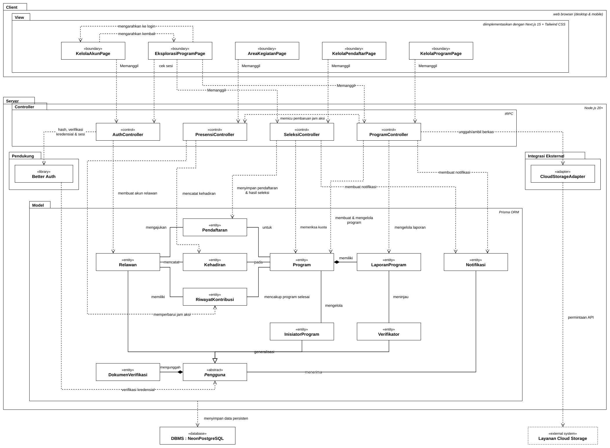

<i>Gambar 2.3. Logical View RekanBumi</i>

Gambar 2.3 menunjukkan *package* Client yang memuat komponen *View* serta *package* Server yang memuat *Controller*, *Model*, Better Auth sebagai pendukung autentikasi, dan CloudStorageAdapter sebagai perantara ke Layanan *Cloud Storage*. Relasi "Memanggil" dan "cek sesi" menunjukkan permintaan dari *View* ke *Controller* melalui tRPC, sedangkan relasi "mengarahkan ke login" menunjukkan EksplorasiProgramPage mengarahkan Relawan yang belum masuk ke KelolaAkunPage. Setelah berhasil masuk, KelolaAkunPage mengembalikan Relawan ke halaman asal melalui `urlKembali` tanpa kebergantungan balik, sehingga tidak terbentuk lingkaran kebergantungan. ProgramController memicu PresensiController untuk memperbarui jam aksi relawan setelah laporan akhir disetujui Verifikator. Relasi dari *Controller* ke *Model* digambarkan sebagai dependensi dengan label sesuai tanggung jawabnya, dan data persisten diakses melalui Prisma ORM serta disimpan pada DBMS : NeonPostgreSQL. Seluruh kebergantungan mengarah ke lapisan yang sama atau ke lapisan di bawahnya; Better Auth dan CloudStorageAdapter tidak bergantung pada kelas *Model*.

Seluruh relasi antarentitas *Model* (asosiasi, agregasi, komposisi, dan generalisasi) serta seluruh pemanggilan *View* ke *Controller* pada Gambar 2.3 sama dengan Tabel 4.2. Untuk dependensi *Controller* ke *Model*, gambar hanya memuat dependensi utama setiap *controller* agar tetap mudah dibaca; daftar lengkap seluruh dependensi terdapat pada Tabel 4.2 dan Gambar 4.1.

### 2.4.2 Physical View

*Physical View* menggambarkan bagaimana komponen perangkat lunak RekanBumi didistribusikan dan dijalankan pada *node-node* fisik/komputasi dalam lingkungan operasionalnya, mengikuti *Client-Server Architecture* yang ditetapkan pada subbab 2.2. *View* ini disajikan dalam bentuk *deployment diagram*, dengan setiap *node* merepresentasikan unit komputasi tempat sekumpulan komponen dijalankan.

*Physical View* dipilih sebagai pelengkap *Logical View* (2.4.1). Jika *Logical View* menunjukkan pembagian tanggung jawab antarkomponen secara struktural mengikuti pola MVC, *Physical View* menunjukkan di mana komponen-komponen tersebut secara fisik dijalankan serta bagaimana *node-node* tersebut saling berkomunikasi melalui jaringan. Pemilihan *view* ini selaras dengan Tabel 2.1 Rancangan Lingkungan Implementasi yang menetapkan spesifikasi *node Client*, *Server*, dan DBMS yang digunakan RekanBumi.

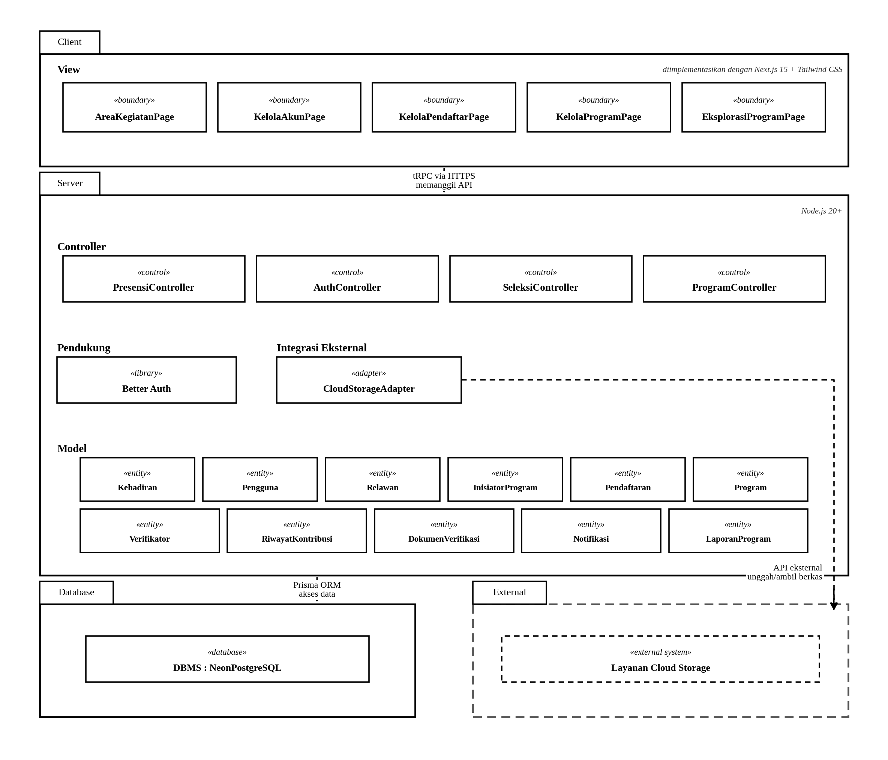

<i>Gambar 2.4. Physical View RekanBumi</i>

Gambar 2.4 menunjukkan empat *node* pada arsitektur RekanBumi. *Node Client Device* merepresentasikan peramban web milik pengguna (Relawan, Inisiator Program, dan Verifikator) yang menjalankan seluruh komponen *View*: KelolaAkunPage, KelolaProgramPage, EksplorasiProgramPage, KelolaPendaftarPage, dan AreaKegiatanPage. *Node Application Server* menjalankan seluruh komponen *Controller* (AuthController, ProgramController, SeleksiController, PresensiController), seluruh komponen *Model* (Pengguna, Relawan, InisiatorProgram, Verifikator, Program, Pendaftaran, DokumenVerifikasi, Kehadiran, LaporanProgram, Notifikasi, RiwayatKontribusi), komponen pendukung Better Auth, serta CloudStorageAdapter sebagai komponen integrasi eksternal. *Node Database Server* menjalankan DBMS : NeonPostgreSQL sebagai basis data terpusat.

Komunikasi antara *Client Device* dan *Application Server* dilakukan melalui tRPC di atas protokol HTTPS, diberi label "memanggil API". Komunikasi antara *Application Server* dan *Database Server* dilakukan melalui Prisma ORM, diberi label "akses data". Sistem di luar P/L, yaitu layanan *Cloud Storage* eksternal yang diakses CloudStorageAdapter untuk menyimpan dan mengambil dokumen legalitas serta foto laporan, digambarkan dengan garis putus-putus dan *node* bertanda «external».

 

---

# BAB 3: Realisasi Use Case

## 3.1 Use Case Daftar program

**ID Use Case:** UC01  
**Nama Use Case:** Daftar program  
**Kebutuhan fungsional terkait:** KF01, KF10

### 3.1.1 Identifikasi Kelas

Tabel 3.1 memuat kelas perancangan yang terlibat dalam UC01 beserta kelas analisis terkait pada SKPL.

Tabel 3.1. Identifikasi Kelas Use Case UC01

| No | Nama Kelas Perancangan | Nama Kelas Analisis Terkait |
|:--- | :--- | :--- |
| 1 | C01 Program | Program |
| 2 | C02 Pendaftaran | Pendaftaran |
| 3 | C03 Relawan | Relawan |
| 4 | C04 Pengguna | Pengguna |
| 5 | C05 InisiatorProgram | InisiatorProgram |
| 6 | C07 DokumenVerifikasi | DokumenVerifikasi |
| 7 | C12 KelolaAkunPage | KelolaAkunPage |
| 8 | C13 AuthController | AuthController |
| 9 | C14 KelolaProgramPage | KelolaProgramPage |
| 10 | C15 ProgramController | ProgramController |
| 11 | C16 EksplorasiProgramPage | EksplorasiProgramPage |
| 12 | C18 SeleksiController | SeleksiController |
| 13 | C21 CloudStorageAdapter | - (kelas baru tahap perancangan) |
| 14 | C22 BetterAuth | - (kelas baru tahap perancangan) |

### 3.1.2 Sequence Diagram

- **Skenario Normal**

Gambar 3.1 menunjukkan *sequence diagram* UC01 untuk Skenario Normal. Diagram memakai fragmen alt untuk membedakan pendaftaran oleh Relawan dan oleh Inisiator Program. Pada operand [Relawan], KelolaAkunPage meneruskan data diri dan berkas ke AuthController melalui buatAkunBaru(). AuthController memeriksa kelengkapan dan status verifikasi data, mendaftarkan kredensial ke BetterAuth (kata sandi di-*hash* di dalam BetterAuth), mengunggah berkas melalui CloudStorageAdapter, lalu membuat objek Relawan dan DokumenVerifikasi. Setelah akun terbentuk, Relawan memilih program; EksplorasiProgramPage memastikan sesi aktif melalui cekSesi(), lalu permohonan pendaftaran diproses oleh SeleksiController yang meminta Relawan memeriksa kelengkapan data dan kelayakannya sebelum membuat objek Pendaftaran. Pada operand [Inisiator Program], Inisiator Program terlebih dahulu membuat akun melalui KelolaAkunPage dengan alur buatAkunBaru() yang sama dengan Relawan: AuthController memeriksa kelengkapan dan status verifikasi data, mendaftarkan kredensial ke BetterAuth, lalu membuat objek InisiatorProgram. Pada registrasi ini parameter berkas dikirim kosong karena dokumen legalitas lembaga diunggah kemudian melalui formulir program. Setelah itu, Inisiator Program mengisi formulir program pada KelolaProgramPage, dan ProgramController memvalidasi data program, memeriksa status verifikasi InisiatorProgram, mengunggah berkas, serta membuat objek DokumenVerifikasi dan Program.

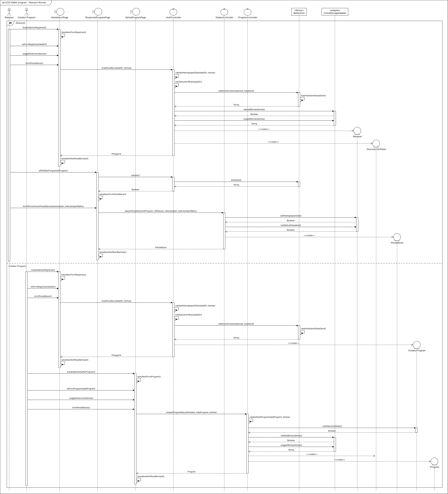

<i>Gambar 3.1. Sequence Diagram UC01 - Skenario Normal</i>

- **Skenario Alternatif 1: Data Diri Relawan Tidak Lengkap**

Gambar 3.2 menunjukkan *sequence diagram* UC01 untuk Skenario Alternatif 1: Data Diri Relawan Tidak Lengkap. Diagram memuat tiga alur yang masing-masing gagal pada pemeriksaan kelengkapan: registrasi akun Relawan gagal pada validasiKelengkapanData() di AuthController, permohonan pendaftaran program gagal pada cekKelengkapanData() di Relawan, dan pendaftaran program oleh Inisiator gagal pada validasiDataProgram() di ProgramController. Pada setiap alur, tidak ada objek yang dibuat dan halaman terkait menampilkan pesan error yang ditandai dengan *guard* [data tidak lengkap].

<i>Gambar 3.2. Sequence Diagram UC01 - Skenario Alternatif 1: Data Diri Relawan Tidak Lengkap</i>

### 3.1.3 Diagram Kelas

Gambar 3.3 menunjukkan diagram kelas UC01 yang terdiri atas kelas-kelas pada Tabel 3.1. Setiap kelas ditampilkan lengkap dengan atribut dan operasinya sesuai Tabel 4.1, dan relasi antarkelas mengikuti Tabel 4.2. Diagram disusun berlapis dari *View*, *Controller*, kelas pendukung dan integrasi eksternal (BetterAuth dan CloudStorageAdapter), hingga *Model*, dengan superkelas Pengguna di atas Relawan dan InisiatorProgram. Seluruh operasi yang dipanggil pada *sequence diagram* 3.1.2 terdapat pada kelas yang bersangkutan.

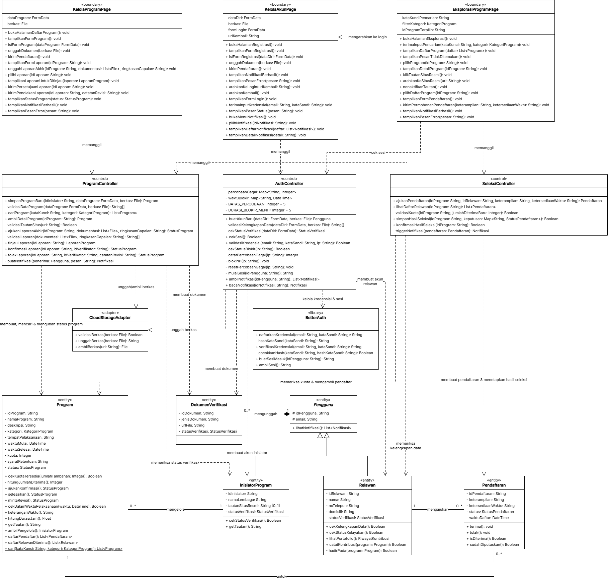

<i>Gambar 3.3. Diagram Kelas Use Case UC01 - Daftar program</i>

 

## 3.2 Use Case Login akun

**ID Use Case:** UC02  
**Nama Use Case:** Login akun  
**Kebutuhan fungsional terkait:** KF06

### 3.2.1 Identifikasi Kelas

Tabel 3.2 memuat kelas perancangan yang terlibat dalam UC02 beserta kelas analisis terkait pada SKPL.

Tabel 3.2. Identifikasi Kelas Use Case UC02

| No | Nama Kelas Perancangan | Nama Kelas Analisis Terkait |
|:--- | :--- | :--- |
| 1 | C12 KelolaAkunPage | KelolaAkunPage |
| 2 | C13 AuthController | AuthController |
| 3 | C16 EksplorasiProgramPage | EksplorasiProgramPage |
| 4 | C22 BetterAuth | - (kelas baru tahap perancangan) |

### 3.2.2 Sequence Diagram

- **Skenario Normal**

Gambar 3.4 menunjukkan *sequence diagram* UC02 untuk Skenario Normal. Ketika Relawan menekan tombol daftar pada halaman program, EksplorasiProgramPage memeriksa sesi melalui cekSesi() dan, karena Relawan belum masuk, mengarahkannya ke halaman login dengan arahkanKeLogin(). Kredensial yang dimasukkan divalidasi oleh AuthController: status blokir IP diperiksa, kredensial diverifikasi oleh BetterAuth (yang mencocokkan *hash* kata sandi dan mengembalikan idPengguna), percobaan gagal direset, lalu sesi dimulai dan dibuat melalui buatSesiMasuk(). KelolaAkunPage menampilkan status keberhasilan dan mengarahkan Relawan kembali ke halaman program asal dengan arahkanKembali().

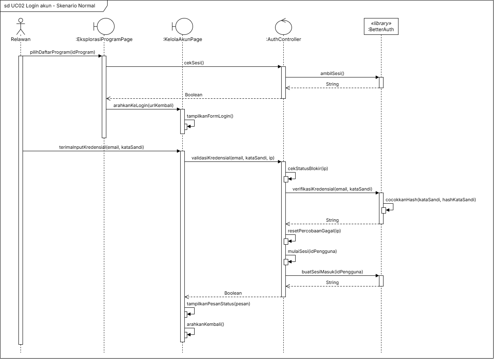

<i>Gambar 3.4. Sequence Diagram UC02 - Skenario Normal</i>

- **Skenario Alternatif 1: Kredensial Salah**

Gambar 3.5 menunjukkan *sequence diagram* UC02 untuk Skenario Alternatif 1: Kredensial Salah. Seperti pada skenario normal, Relawan yang belum masuk menekan tombol daftar sehingga EksplorasiProgramPage memeriksa sesi melalui cekSesi() dan mengarahkannya ke halaman login dengan arahkanKeLogin(). Setelah kredensial dimasukkan, cocokkanHash() pada BetterAuth bernilai false sehingga verifikasiKredensial() tidak mengembalikan idPengguna. AuthController mencatat percobaan gagal dari IP tersebut, dan KelolaAkunPage menampilkan pesan gagal masuk yang ditandai dengan *guard* [kredensial salah].

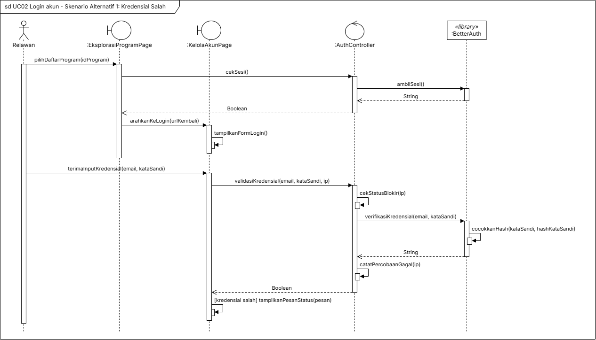

<i>Gambar 3.5. Sequence Diagram UC02 - Skenario Alternatif 1: Kredensial Salah</i>

- **Skenario Alternatif 2: Akun Terkunci Sementara**

Gambar 3.6 menunjukkan *sequence diagram* UC02 untuk Skenario Alternatif 2: Akun Terkunci Sementara. Fragmen loop menggambarkan lima percobaan masuk yang gagal secara berturut-turut. Pada setiap percobaan, AuthController memeriksa status blokir IP, BetterAuth gagal memverifikasi kredensial karena cocokkanHash() bernilai false, lalu catatPercobaanGagal() menambah jumlah percobaan gagal dari IP tersebut. Ketika jumlahnya mencapai BATAS_PERCOBAAN (5), AuthController memblokir IP melalui blokirIP() di dalam fragmen opt. Pada percobaan masuk berikutnya, cekStatusBlokir() bernilai true sehingga permintaan masuk ditolak, dan KelolaAkunPage menampilkan peringatan bahwa IP diblokir sementara selama 5 menit, yang ditandai dengan *guard* [IP diblokir].

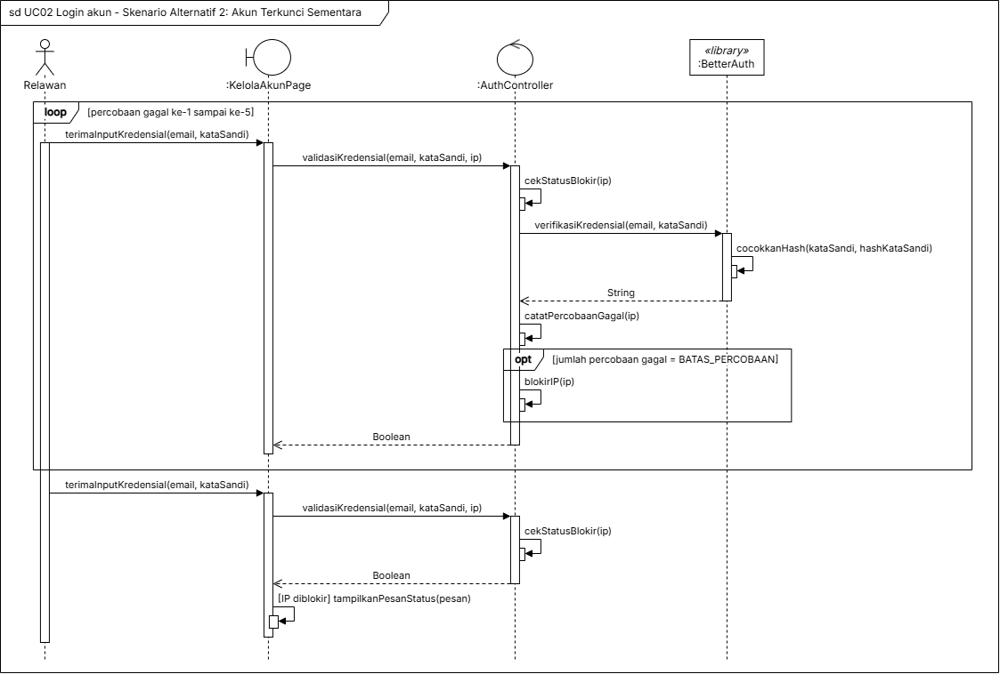

<i>Gambar 3.6. Sequence Diagram UC02 - Skenario Alternatif 2: Akun Terkunci Sementara</i>

### 3.2.3 Diagram Kelas

Gambar 3.7 menunjukkan diagram kelas UC02 yang terdiri atas kelas-kelas pada Tabel 3.2. Setiap kelas ditampilkan lengkap dengan atribut dan operasinya sesuai Tabel 4.1, dan relasi antarkelas mengikuti Tabel 4.2. BetterAuth hanya dipanggil oleh AuthController dan mengembalikan idPengguna tanpa bergantung pada kelas Pengguna, sedangkan kembali ke halaman asal dilakukan melalui *self-call* arahkanKembali() sehingga tidak ada lingkaran kebergantungan antarhalaman. Seluruh operasi yang dipanggil pada *sequence diagram* 3.2.2 terdapat pada kelas yang bersangkutan.

<i>Gambar 3.7. Diagram Kelas Use Case UC02 - Login akun</i>

 

## 3.3 Use Case Mencari program

**ID Use Case:** UC03  
**Nama Use Case:** Mencari program
**Kebutuhan fungsional terkait:** KF03, KF04

### 3.3.1 Identifikasi Kelas

Tabel 3.3 memuat kelas perancangan yang terlibat dalam UC03 beserta kelas analisis terkait pada SKPL.

Tabel 3.3. Identifikasi Kelas Use Case UC03

| No | Nama Kelas Perancangan | Nama Kelas Analisis Terkait |
|:--- | :--- | :--- |
| 1 | C01 Program | Program |
| 2 | C15 ProgramController | ProgramController |
| 3 | C16 EksplorasiProgramPage | EksplorasiProgramPage |

### 3.3.2 Sequence Diagram

- **Skenario Normal**

Gambar 3.8 menunjukkan sequence diagram UC03 untuk Skenario Normal. Relawan membuka halaman eksplorasi melalui bukaHalamanEksplorasi(), kemudian memasukkan kata kunci dan memilih kategori melalui terimaInputPencarian(kataKunci, kategori) pada EksplorasiProgramPage. EksplorasiProgramPage meneruskan permintaan ke ProgramController melalui cariProgram(kataKunci, kategori), yang kemudian memanggil operasi statis Program.cari(kataKunci, kategori) sebagai pemilik data pencarian. Daftar program yang ditemukan dikembalikan berturut-turut ke ProgramController lalu ke EksplorasiProgramPage, yang menampilkannya melalui tampilkanDaftarProgram(daftar).

<i>Gambar 3.8. Sequence Diagram UC03 - Skenario Normal</i>

- **Skenario Alternatif 1: Program Tidak Ditemukan**

Gambar 3.9 menunjukkan sequence diagram UC03 untuk Skenario Alternatif 1: Program Tidak Ditemukan. Alur berjalan sama seperti skenario normal hingga Program.cari(kataKunci, kategori) dipanggil, tetapi pencarian tidak menghasilkan program yang sesuai sehingga daftar kosong dikembalikan. EksplorasiProgramPage kemudian memanggil tampilkanPesanTidakDitemukan(), bukan tampilkanDaftarProgram(), untuk memberi tahu Relawan bahwa tidak ada program yang cocok.

<i>Gambar 3.9. Sequence Diagram UC03 - Skenario Alternatif 1: Program Tidak Ditemukan</i>

### 3.3.3 Diagram Kelas

Gambar 3.10 menunjukkan diagram kelas UC03 yang terdiri atas kelas-kelas pada Tabel 3.3. Setiap kelas ditampilkan lengkap dengan atribut dan operasinya sesuai Tabel 4.1, dan relasi antarkelas mengikuti Tabel 4.2 (EksplorasiProgramPage bergantung pada ProgramController, dan ProgramController bergantung pada Program). Seluruh operasi yang dipanggil pada sequence diagram 3.3.2 — cariProgram(), Program.cari() (statis), tampilkanDaftarProgram(), dan tampilkanPesanTidakDitemukan() — terdapat pada kelas yang bersangkutan.

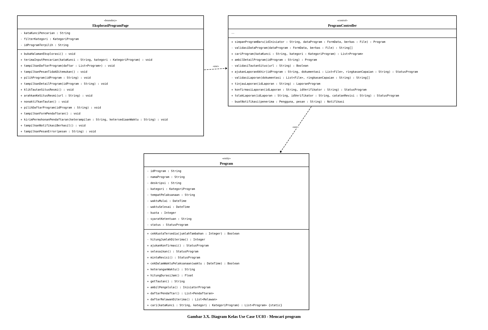

<i>Gambar 3.10. Diagram Kelas Use Case UC03 - Mencari program</i>

 

## 3.4 Use Case Mengunjungi situs program

**ID Use Case:** UC04  
**Nama Use Case:** Mengunjungi situs program
**Kebutuhan fungsional terkait:** KF02

### 3.4.1 Identifikasi Kelas

Tabel 3.4 memuat kelas perancangan yang terlibat dalam UC04 beserta kelas analisis terkait pada SKPL.

Tabel 3.4. Identifikasi Kelas Use Case UC04

| No | Nama Kelas Perancangan | Nama Kelas Analisis Terkait |
|:--- | :--- | :--- |
| 1 | C01 Program | Program |
| 2 | C05 InisiatorProgram | InisiatorProgram |
| 3 | C15 ProgramController | ProgramController |
| 4 | C16 EksplorasiProgramPage | EksplorasiProgramPage |

### 3.4.2 Sequence Diagram

- **Skenario Normal**

Gambar 3.11 menunjukkan sequence diagram UC04 untuk Skenario Normal. Relawan memilih program dari daftar melalui pilihProgram(idProgram) pada EksplorasiProgramPage, yang meneruskan permintaan ke ProgramController melalui ambilDetailProgram(idProgram). Untuk memperoleh tautan situs resmi program, ProgramController memanggil Program.getTautan(); Program menelusuri pengelolanya melalui ambilPengelola() (self-call) lalu memanggil InisiatorProgram.getTautan(), yang mengembalikan tautanSitusResmi miliknya. Program meneruskan tautan tersebut ke ProgramController, yang memvalidasinya melalui validasiTautanSitus(url). Detail program beserta status tautan dikembalikan ke EksplorasiProgramPage, yang menampilkannya melalui tampilkanDetailProgram(idProgram). Ketika Relawan mengklik tautan situs resmi (klikTautanSitusResmi()), EksplorasiProgramPage mengarahkan Relawan ke situs tersebut pada tab baru melalui arahkanKeSitusResmi(url).

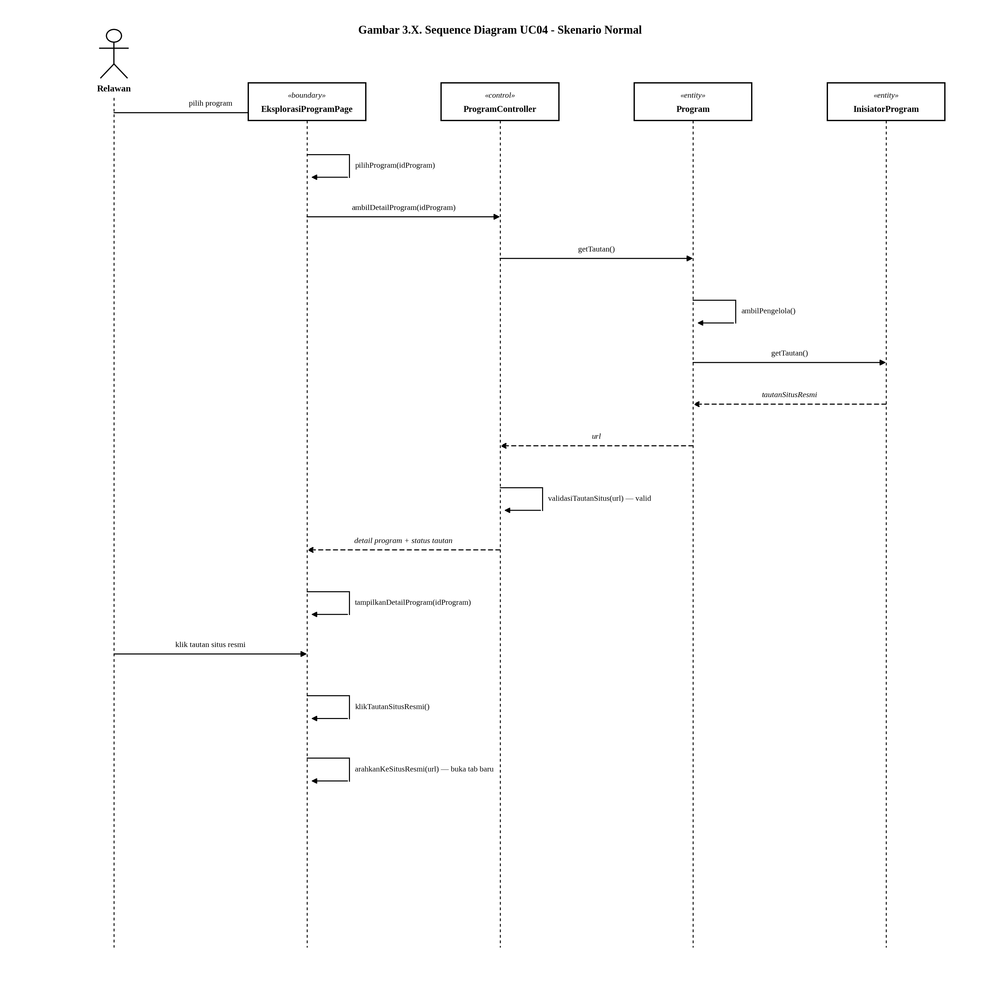

<i>Gambar 3.11. Sequence Diagram UC04 - Skenario Normal</i>

- **Skenario Alternatif 1: Tautan Tidak Disediakan**

Gambar 3.12 menunjukkan sequence diagram UC04 untuk Skenario Alternatif 1: Tautan Tidak Disediakan. Alur berjalan sama seperti skenario normal hingga InisiatorProgram.getTautan() dipanggil, tetapi lembaga pengelola belum mencantumkan tautan situs resmi sehingga nilai yang dikembalikan kosong. Akibatnya, validasiTautanSitus(url) pada ProgramController bernilai tidak valid, dan EksplorasiProgramPage memanggil nonaktifkanTautan() sebelum menampilkan detail program, sehingga tombol/tautan situs resmi tidak dapat diklik oleh Relawan.

<i>Gambar 3.12. Sequence Diagram UC04 - Skenario Alternatif 1: Tautan Tidak Disediakan</i>

### 3.4.3 Diagram Kelas

Gambar 3.13 menunjukkan diagram kelas UC04 yang terdiri atas kelas-kelas pada Tabel 3.4. Setiap kelas ditampilkan lengkap dengan atribut dan operasinya sesuai Tabel 4.1, dan relasi antarkelas mengikuti Tabel 4.2: EksplorasiProgramPage bergantung pada ProgramController, ProgramController bergantung pada Program, dan Program berasosiasi dengan InisiatorProgram (multiplisitas 0..* : 1) yang dinavigasi melalui ambilPengelola(). Seluruh operasi yang dipanggil pada sequence diagram 3.4.2 — ambilDetailProgram(), getTautan() (pada Program maupun InisiatorProgram), ambilPengelola(), validasiTautanSitus(), tampilkanDetailProgram(), klikTautanSitusResmi(), arahkanKeSitusResmi(), dan nonaktifkanTautan() — terdapat pada kelas yang bersangkutan.

<i>Gambar 3.13. Diagram Kelas Use Case UC04 - Mengunjungi situs program</i>

 

## 3.5 Use Case Menyeleksi calon relawan pendaftar

**ID Use Case:** UC05  
**Nama Use Case:** Menyeleksi calon relawan pendaftar

### 3.5.1 Identifikasi Kelas

Identifikasi kelas yang terkait dengan use case tersebut. Kelas di tahap perancangan dapat berbeda dengan dengan kelas di tahap analisis. Dapat menggunakan tabel di bawah:

Tabel 3.5.1 Identifikasi Kelas Use Case [UC05]

| No | Nama Kelas Perancangan | Nama Kelas Analisis Terkait |
|:--- | :--- | :--- |
| 1 | C01 Program| Program |
| 2 | C02 Pendaftaran | Pendaftaran |
| 3 | C17 KelolaPendaftarPage | KelolaPendaftarPage |
| 4 | C18 SeleksiController | SeleksiController |

### 3.5.2 Sequence Diagram

- **Skenario Normal**

Gambar 3.14 menunjukkan sequence diagram UC05 untuk Skenario Normal. Inisiator Program membuka halaman pendaftar melalui bukaKelolaPendaftar(idProgram) pada KelolaPendaftarPage, yang meminta daftar pendaftar ke SeleksiController melalui lihatDaftarRelawan(idProgram). SeleksiController memperoleh daftar tersebut dari Program.daftarPendaftar(), lalu mengembalikannya sebagai List<Pendaftaran> sehingga KelolaPendaftarPage dapat menampilkannya melalui tampilkanDaftarPendaftar(daftar) dan tampilkanFormSeleksi(). Inisiator Program menentukan keputusan untuk setiap pendaftar melalui pilihStatusSeleksi(idPendaftaran, status), kemudian mengirimkannya melalui kirimHasilSeleksi(), yang diteruskan ke SeleksiController melalui simpanHasilSeleksi(idProgram, keputusan). Untuk setiap keputusan seleksi (fragmen loop), keputusan DITERIMA divalidasi terhadap kuota melalui validasiKuota(idProgram, jumlahDiterimaBaru), yang memanggil Program.cekKuotaTersedia(jumlahTambahan) (Program menghitung jumlah relawan diterima melalui hitungJumlahDiterima()) dan dilanjutkan dengan Pendaftaran.terima(), sedangkan keputusan DITOLAK langsung memanggil Pendaftaran.tolak(). Hasil penyimpanan dikembalikan sebagai Boolean dan KelolaPendaftarPage menampilkan tampilkanNotifikasiBerhasil().

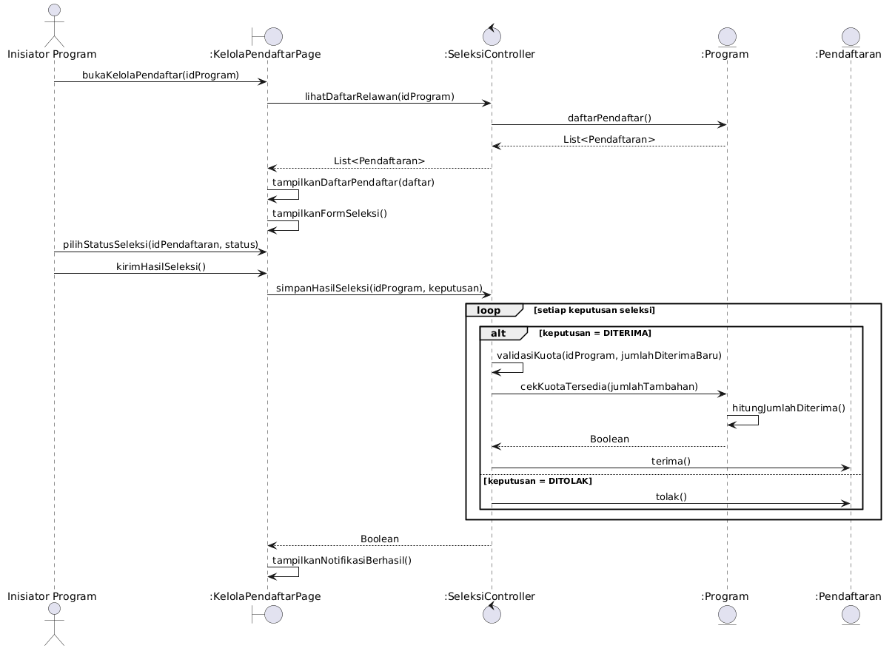

<i>Gambar 3.14. Sequence Diagram UC05 - Skenario Normal</i>

- **Skenario Alternatif 1: Kuota Relawan Telah Terpenuhi**

Gambar 3.15 menunjukkan sequence diagram UC05 untuk Skenario Alternatif 1: Kuota Relawan Telah Terpenuhi. Alur dimulai ketika Inisiator Program mengirim hasil seleksi melalui kirimHasilSeleksi(), yang diteruskan ke SeleksiController melalui simpanHasilSeleksi(idProgram, keputusan). 
Pada validasiKuota(idProgram, jumlahDiterimaBaru), Program.cekKuotaTersedia(jumlahTambahan) mengembalikan false karena jumlah relawan diterima akan melampaui kuota. SeleksiController mengembalikan nilai tersebut ke KelolaPendaftarPage, yang menampilkan tampilkanPesanError(pesan). Inisiator Program kemudian mengubah pilihannya menjadi DITOLAK melalui pilihStatusSeleksi(idPendaftaran, status), dan alur kembali ke simpanHasilSeleksi() pada skenario normal.

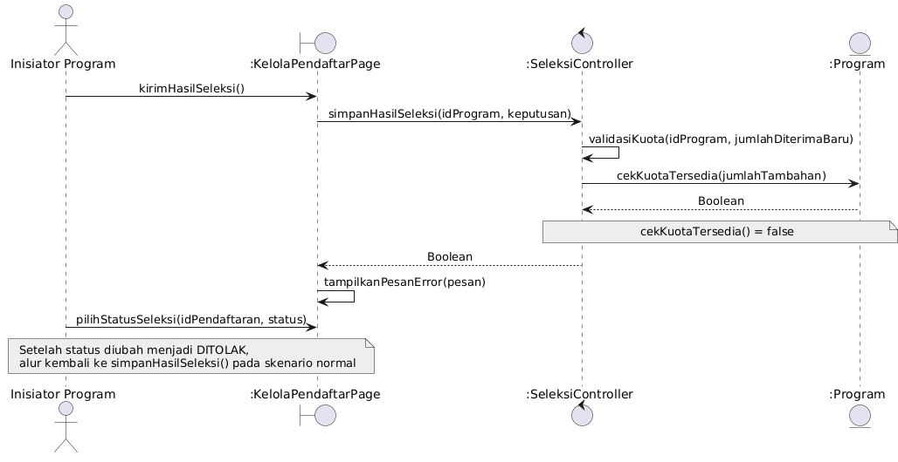

<i>Gambar 3.15. Sequence Diagram UC05 - Skenario Alternatif 1: Kuota Relawan Telah Terpenuhi</i>

### 3.5.3 Diagram Kelas

Gambar 3.16 menunjukkan diagram kelas UC05 yang terdiri atas kelas-kelas pada Tabel 3.5. Setiap kelas ditampilkan lengkap dengan atribut dan operasinya sesuai Tabel 4.1, dan relasi antarkelas mengikuti Tabel 4.2: KelolaPendaftarPage bergantung pada SeleksiController (memanggil), SeleksiController bergantung pada Pendaftaran (membuat pendaftaran & menetapkan hasil seleksi) dan pada Program (memeriksa kuota & mengambil pendaftar), serta Program berasosiasi dengan Pendaftaran (multiplisitas 1 : 0..*, label "untuk"). Seluruh operasi yang dipanggil pada sequence diagram 3.5.2 — lihatDaftarRelawan(), simpanHasilSeleksi(), validasiKuota(), daftarPendaftar(), cekKuotaTersedia(), hitungJumlahDiterima(), terima(), tolak(), bukaKelolaPendaftar(), tampilkanDaftarPendaftar(), tampilkanFormSeleksi(), pilihStatusSeleksi(), kirimHasilSeleksi(), tampilkanNotifikasiBerhasil(), dan tampilkanPesanError() — terdapat pada kelas yang bersangkutan.

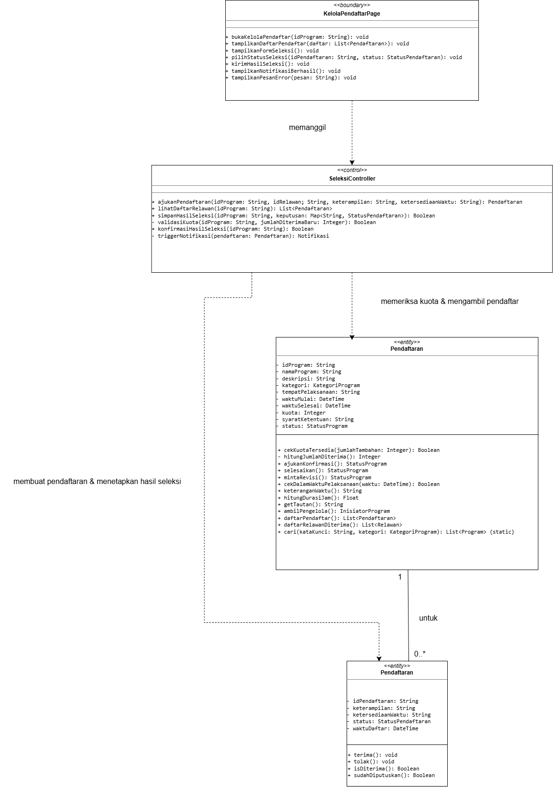

<i>Gambar 3.16. Diagram Kelas Use Case UC05 - Menyeleksi calon relawan pendaftar</i>

 
## 3.6 Konfirmasi Status Pendaftaran

**ID Use Case:** UC06 
**Nama Use Case:** Konfirmasi Status Pendaftaran

### 3.6.1 Identifikasi Kelas

Identifikasi kelas yang terkait dengan use case tersebut. Kelas di tahap perancangan dapat berbeda dengan dengan kelas di tahap analisis. Dapat menggunakan tabel di bawah:

Tabel 3.6.1 Identifikasi Kelas Use Case [UC05]

| No | Nama Kelas Perancangan | Nama Kelas Analisis Terkait |
|:--- | :--- | :--- |
| 1 | C01 Program| Program |
| 2 | C02 Pendaftaran | Pendaftaran |
| 3 | C03 Relawan | Relawan |
| 4 | C04 Pengguna | Pengguna |
| 5 | C10 Notifikasi |  |
| 6 | C12 KelolaAkunPage | KelolaAkunPage |
| 7 | C13 AuthController | AuthController |
| 8 | C17 KelolaPendaftarPage | KelolaPendaftarPage |
| 9 | C18 SeleksiController | SeleksiController |

### 3.6.2 Sequence Diagram

- **Skenario Normal**

Gambar 3.17 menunjukkan sequence diagram UC06 untuk Skenario Normal. Inisiator Program mengonfirmasi hasil seleksi melalui kirimKonfirmasiHasil() pada KelolaPendaftarPage, yang meneruskannya ke SeleksiController melalui konfirmasiHasilSeleksi(idProgram). SeleksiController memperoleh daftar pendaftar dari Program.daftarPendaftar(), lalu pada fragmen loop memastikan setiap pendaftaran telah diputuskan melalui Pendaftaran.sudahDiputuskan(). Setelah seluruh pendaftaran terbukti sudah diputuskan, fragmen loop berikutnya membuat notifikasi untuk setiap pendaftaran melalui triggerNotifikasi(pendaftaran), yang membuat objek Notifikasi (<<create>>) dan mengirimkannya melalui kirim(). Hasil dikembalikan sebagai Boolean dan KelolaPendaftarPage menampilkan tampilkanKonfirmasiHasil(). Selanjutnya, Relawan membuka menu notifikasi melalui bukaMenuNotifikasi() pada KelolaAkunPage, yang meminta ambilNotifikasi(idPengguna) ke AuthController; AuthController memperoleh daftar notifikasi dari Relawan.lihatNotifikasi() (diwarisi dari Pengguna), kemudian KelolaAkunPage menampilkannya melalui tampilkanDaftarNotifikasi(daftar). Ketika Relawan memilih notifikasi melalui pilihNotifikasi(idNotifikasi), KelolaAkunPage memanggil bacaNotifikasi(idNotifikasi) pada AuthController, yang menandai notifikasi terbaca melalui Notifikasi.baca() dan mengambil isinya melalui Notifikasi.showDetail(), lalu menampilkannya melalui tampilkanDetailNotifikasi(detail).

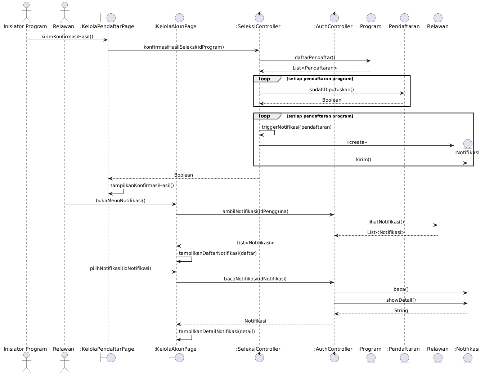

<i>Gambar 3.17. Sequence Diagram UC06 - Skenario Normal</i>

- **Skenario Alternatif 1: Masih Ada Pendaftar yang Belum Diseleksi**

Gambar 3.18 menunjukkan sequence diagram UC06 untuk Skenario Alternatif 1: Masih Ada Pendaftar yang Belum Diseleksi. Alur berjalan sama seperti skenario normal hingga SeleksiController memanggil Program.daftarPendaftar() dan memeriksa setiap pendaftaran melalui Pendaftaran.sudahDiputuskan(). 
Karena minimal satu pendaftaran bernilai false, konfirmasiHasilSeleksi(idProgram) mengembalikan false dan tidak ada notifikasi yang dibuat maupun dikirim. KelolaPendaftarPage kemudian menampilkan tampilkanPesanError(pesan) sehingga Inisiator Program dapat menyelesaikan seleksi terlebih dahulu.

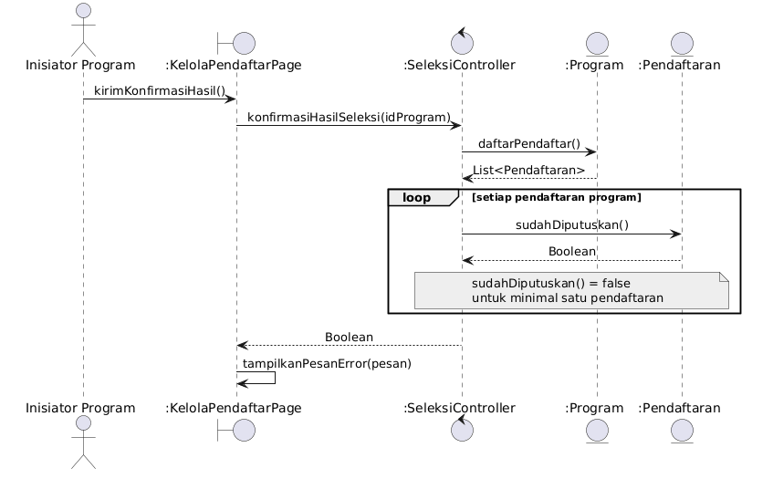

<i>Gambar 3.18. Sequence Diagram UC06 - Skenario Alternatif 1: Masih Ada Pendaftar yang Belum Diseleksi</i>

### 3.6.3 Diagram Kelas

Gambar 3.19 menunjukkan diagram kelas UC06 yang terdiri atas kelas-kelas pada Tabel 3.6. Setiap kelas ditampilkan lengkap dengan atribut dan operasinya sesuai Tabel 4.1, dan relasi antarkelas mengikuti Tabel 4.2: 
Relawan merupakan generalisasi dari Pengguna; Pengguna berasosiasi dengan Notifikasi (1 : 0..*, "menerima"); Relawan dan Program masing-masing berasosiasi dengan Pendaftaran (1 : 0..*, "mengajukan" dan "untuk"); KelolaAkunPage bergantung pada AuthController dan KelolaPendaftarPage bergantung pada SeleksiController (memanggil); AuthController bergantung pada Relawan (membuat akun relawan) dan Notifikasi (mengambil notifikasi); serta SeleksiController bergantung pada Pendaftaran, Program, Relawan, dan Notifikasi. Seluruh operasi yang dipanggil pada sequence diagram 3.6.2 — konfirmasiHasilSeleksi(), daftarPendaftar(), sudahDiputuskan(), triggerNotifikasi(), kirim(), ambilNotifikasi(), lihatNotifikasi(), bacaNotifikasi(), baca(), showDetail(), kirimKonfirmasiHasil(), tampilkanKonfirmasiHasil(), tampilkanPesanError(), bukaMenuNotifikasi(), pilihNotifikasi(), tampilkanDaftarNotifikasi(), dan tampilkanDetailNotifikasi() — terdapat pada kelas yang bersangkutan.

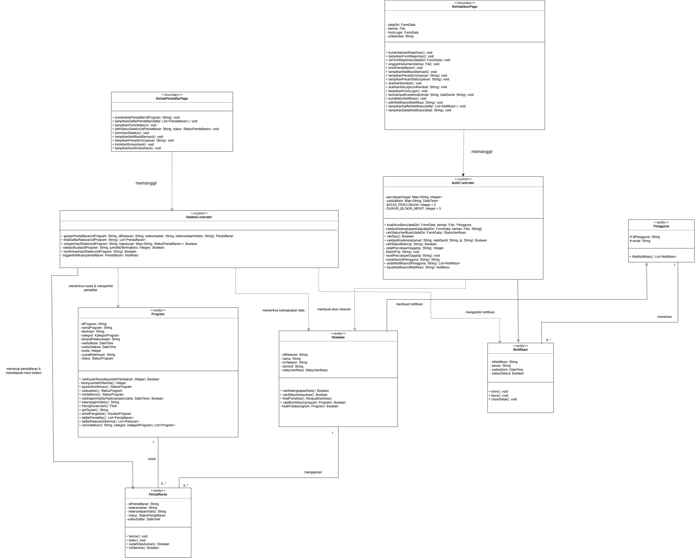

<i>Gambar 3.19. Diagram Kelas Use Case UC06 - Konfirmasi status pendaftaran</i>

 

## 3.7 Use Case 07 : Memperbarui status program
**ID Use Case:** UC07
**Nama Use Case:** Memperbarui Status Program

### 3.7.1 Identifikasi Kelas

Tabel 3.7 memuat kelas perancangan yang terlibat dalam UC07 beserta kelas analisis terkait pada SKPL.

Tabel 3.7. Identifikasi Kelas Use Case [UC07]

| No | Nama Kelas Perancangan | Nama Kelas Analisis Terkait |
|:--- | :--- | :--- |
| 1 | C01 Program | Program |
| 2 | C06 Verifikator | Verifikator |
| 3 | C09 LaporanProgram | LaporanProgram |
| 4 | C10 Notifikasi | Notifikasi |
| 5 | C14 KelolaProgramPage | KelolaProgramPage |
| 6 | C15 ProgramController | ProgramController |
| 7 | C20 PresensiController	| PresensiController |
| 8 | C21 CloudStorageAdapter | CloudStorageAdapter |

### 3.7.2 Sequence Diagram

- **Skenario Normal**

Gambar 3.20 menunjukkan sequence diagram UC08 untuk Skenario Normal. Relawan membuka halaman kegiatan melalui AreaKegiatanPage, kemudian PresensiController memvalidasi status penerimaan relawan dan waktu pelaksanaan program melalui validasiStatusRelawan() dan validasiWaktuPelaksanaan(). Apabila kedua validasi berhasil, sistem mengaktifkan tombol check-in dan menampilkan keterangan waktu kegiatan. Ketika relawan melakukan check-in, PresensiController memproses pencatatan kehadiran melalui prosesCheckIn(). Setelah kehadiran berhasil dicatat, sistem memperbarui portofolio relawan dan menampilkan status check-in. Relawan juga dapat membuka portofolio untuk melihat total jam aksi melalui ambilTotalJamAksi() dan riwayat program melalui ambilRiwayatProgram(), yang kemudian ditampilkan oleh AreaKegiatanPage.

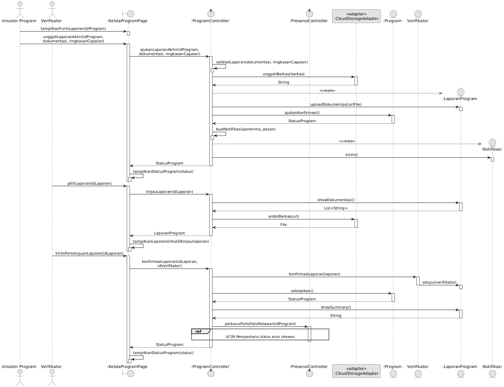

<i>Gambar 3.20 Sequence Diagram UC07 : Memperbarui Status Program </i>

- **Skenario Alternatif 1 : Verifikator Menolak Laporan Akhir**

Gambar 3.21 menunjukkan sequence diagram UC07 untuk skenario alternatif: Laporan Akhir Program Ditolak. Verifikator menolak laporan akhir program dan memberikan catatan revisi sehingga tolakLaporan() dipanggil. Akibatnya, status laporan diperbarui menjadi “Perlu Revisi” melalui updateStatus(), dan sistem mengirimkan notifikasi kepada Inisiator melalui buatNotifikasi() agar laporan dapat diperbaiki.

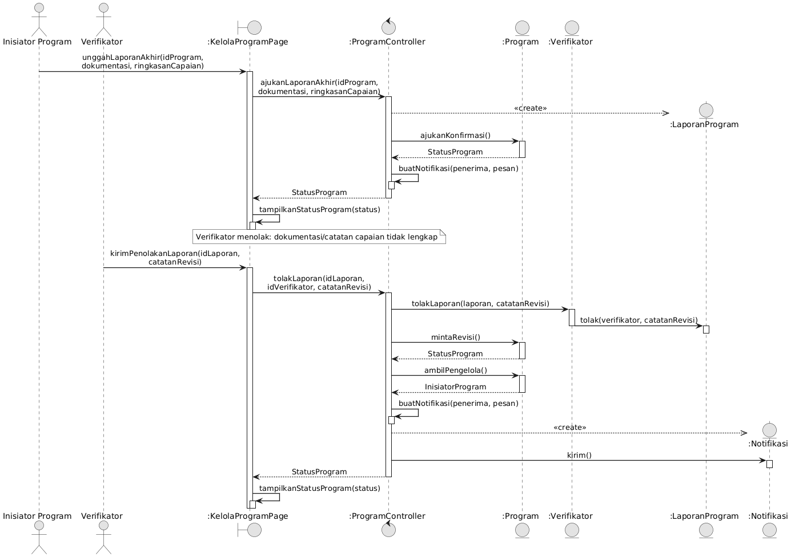

<i>Gambar 3.21 Sequence Diagram UC07 : Memperbarui Status Program - Verifikator Menolak Laporan Akhir</i>

### 3.7.3 Diagram Kelas

Gambar 3.22 menunjukkan diagram kelas UC07 yang terdiri atas kelas-kelas pada Tabel 3.7. Setiap kelas ditampilkan lengkap dengan atribut dan operasinya sesuai Tabel 4.1, dan relasi antarkelas mengikuti Tabel 4.2. Seluruh operasi yang dipanggil pada *sequence diagram* 3.7.2 terdapat pada kelas yang bersangkutan

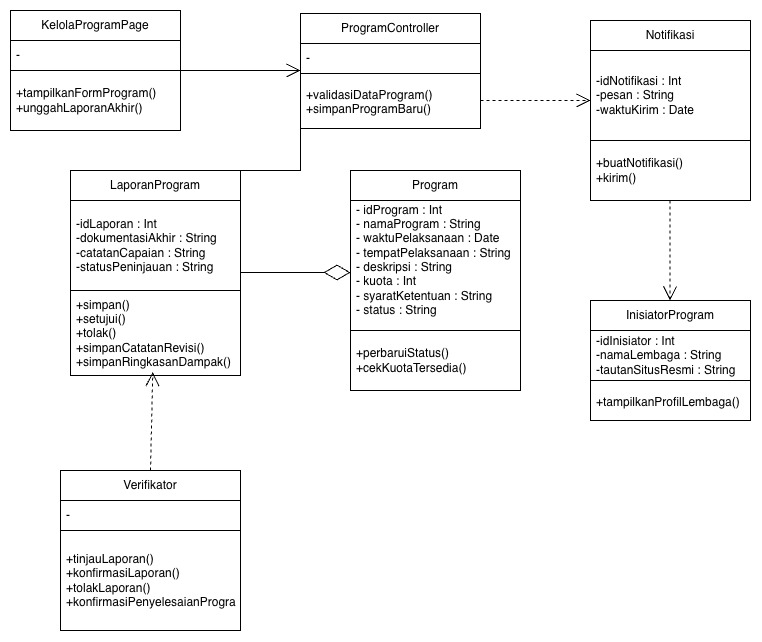

<i>Gambar 3.22 Diagram Kelas UC07 : Memperbarui Status Program</i>

 

## 3.8 Use Case 08 : Konfirmasi kehadiran program
**ID Use Case:** UC08
**Nama Use Case:** Konfirmasi Kehadiran Program

### 3.8.1 Identifikasi Kelas

Tabel 3.8 memuat kelas perancangan yang terlibat dalam UC08 beserta kelas analisis terkait pada SKPL.

Tabel 3.8. Identifikasi Kelas Use Case [UC08]

| No | Nama Kelas Perancangan | Nama Kelas Analisis Terkait |
|:---|:---|:---|
| 1 | C01 Program | Program |
| 2 | C02 Pendaftaran | Pendaftaran |
| 3 | C08 Kehadiran | Kehadiran |
| 4 | C19 AreaKegiatanPage | AreaKegiatanPage |
| 5 | C20 PresensiController | PresensiController |

### 3.8.2 Sequence Diagram

- **Skenario Normal**

Gambar 3.23 menunjukkan sequence diagram UC08 untuk Skenario Normal. Relawan membuka halaman kegiatan melalui AreaKegiatanPage, kemudian PresensiController memvalidasi status penerimaan relawan dan waktu pelaksanaan program melalui validasiStatusRelawan() dan validasiWaktuPelaksanaan(). Apabila kedua validasi berhasil, sistem mengaktifkan tombol check-in dan menampilkan keterangan waktu kegiatan. Ketika relawan melakukan check-in, PresensiController memproses pencatatan kehadiran melalui prosesCheckIn(). Setelah kehadiran berhasil dicatat, sistem memperbarui portofolio relawan dan menampilkan status check-in. Relawan juga dapat membuka portofolio untuk melihat total jam aksi melalui ambilTotalJamAksi() dan riwayat program melalui ambilRiwayatProgram(), yang kemudian ditampilkan oleh AreaKegiatanPage.

<i>Gambar 3.23 Sequence Diagram UC08 : Konfirmasi Kehadiran Program </i>

- **Skenario Alternatif 1** : Check-in di Luar Waktu Pelaksanaan 

Gambar 3.24 menunjukkan sequence diagram UC08 untuk skenario alternatif: Relawan Membuka Halaman di Luar Jadwal Kegiatan. Sistem memvalidasi status relawan dan waktu pelaksanaan kegiatan melalui validasiStatusRelawan() dan validasiWaktuPelaksanaan(). Karena waktu akses berada di luar jadwal kegiatan, tombol check-in dinonaktifkan dan rentang waktu pelaksanaan ditampilkan kepada relawan. Akibatnya, catatKehadiran() tidak dipanggil sehingga catatan kehadiran tidak dibuat.

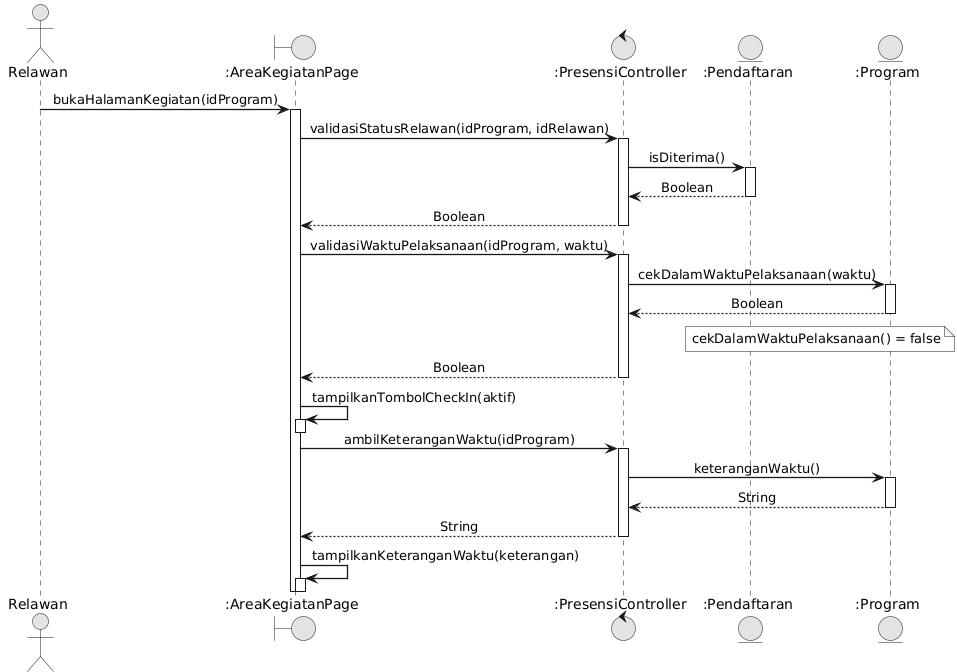

<i>Gambar 3.24 Sequence Diagram UC08 : Konfirmasi Kehadiran program - Check-in di Luar Waktu Pelaksanaan </i>

### 3.8.3 Diagram Kelas

Gambar 3.25 menunjukkan diagram kelas UC08 yang terdiri atas kelas-kelas pada Tabel 3.8. Setiap kelas ditampilkan lengkap dengan atribut dan operasinya sesuai Tabel 4.1, dan relasi antarkelas mengikuti Tabel 4.2. Seluruh operasi yang dipanggil pada *sequence diagram* 3.8.2 terdapat pada kelas yang bersangkutan

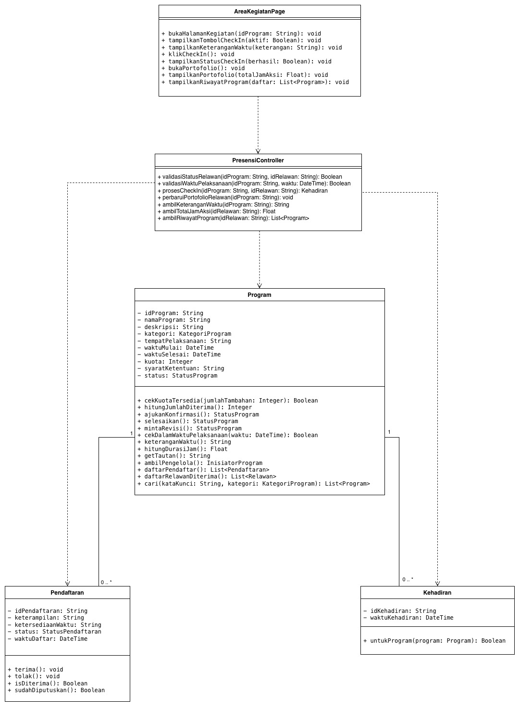

<i>Gambar 3.25 Diagram Kelas UC08 : Konfirmasi Kehadiran Program </i>

## 3.9 Use Case Memperbarui status akun relawan

**ID Use Case:** UC09  
**Nama Use Case:** Memperbarui status akun relawan  
**Kebutuhan fungsional terkait:** KF15

### 3.9.1 Identifikasi Kelas

Tabel 3.9 memuat kelas perancangan yang terlibat dalam UC09 beserta kelas analisis terkait pada SKPL.

Tabel 3.9. Identifikasi Kelas Use Case UC09

| No | Nama Kelas Perancangan | Nama Kelas Analisis Terkait |
|:--- | :--- | :--- |
| 1 | C01 Program | Program |
| 2 | C02 Pendaftaran | Pendaftaran |
| 3 | C03 Relawan | Relawan |
| 4 | C08 Kehadiran | Kehadiran |
| 5 | C11 RiwayatKontribusi | RiwayatKontribusi |
| 6 | C14 KelolaProgramPage | KelolaProgramPage |
| 7 | C15 ProgramController | ProgramController |
| 8 | C19 AreaKegiatanPage | AreaKegiatanPage |
| 9 | C20 PresensiController | PresensiController |

### 3.9.2 Sequence Diagram

- **Skenario Normal**

Gambar 3.26 menunjukkan *sequence diagram* UC09 untuk Skenario Normal. Persetujuan laporan akhir oleh Verifikator dirujuk ke UC07 melalui fragmen `ref`. Setelah itu, PresensiController meminta Program menyusun daftar relawan yang pendaftarannya diterima. Untuk setiap relawan, PresensiController meminta Relawan mencatat kontribusinya. Relawan memeriksa kehadirannya sendiri dengan menelusuri setiap catatan Kehadiran miliknya, dan apabila hadir, RiwayatKontribusi menambahkan program itu sekaligus menghitung jam aksinya dari durasi program. Setiap keputusan diambil oleh objek pemilik informasinya (gaya kendali didelegasikan). Ketika Relawan membuka portofolio, AreaKegiatanPage meminta total jam aksi (`ambilTotalJamAksi()`) dan daftar program selesai (`ambilRiwayatProgram()`) kepada PresensiController, lalu menampilkan keduanya; setiap nilai yang ditampilkan berasal dari panah balik pada diagram.

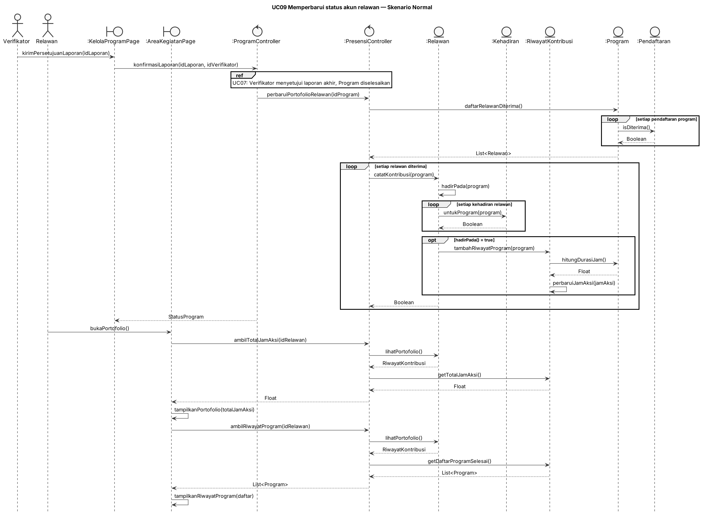

<i>Gambar 3.26. Sequence Diagram UC09 - Skenario Normal</i>

- **Skenario Alternatif 1: Relawan Tidak Melakukan Check-in Saat Kegiatan**

Gambar 3.27 menunjukkan *sequence diagram* UC09 untuk Skenario Alternatif 1: Relawan Tidak Melakukan Check-in Saat Kegiatan. Relawan tidak memiliki catatan Kehadiran untuk program tersebut sehingga `hadirPada()` bernilai false. Akibatnya, `tambahRiwayatProgram()` tidak dipanggil, `catatKontribusi()` mengembalikan false, dan total jam aksi yang ditampilkan pada portofolio tidak bertambah untuk program tersebut.

<i>Gambar 3.27. Sequence Diagram UC09 - Skenario Alternatif 1: Relawan Tidak Melakukan Check-in Saat Kegiatan</i>

### 3.9.3 Diagram Kelas

Gambar 3.28 menunjukkan diagram kelas UC09 yang terdiri atas kelas-kelas pada Tabel 3.9. Setiap kelas ditampilkan lengkap dengan atribut dan operasinya sesuai Tabel 4.1, dan relasi antarkelas mengikuti Tabel 4.2. Seluruh operasi yang dipanggil pada *sequence diagram* 3.9.2 terdapat pada kelas yang bersangkutan.

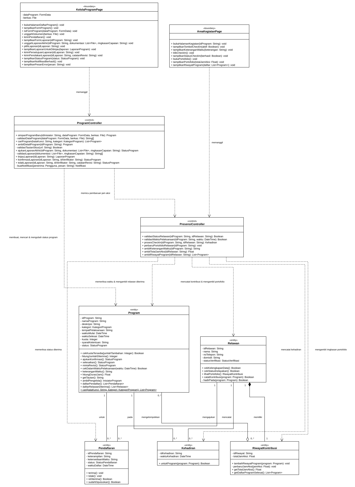

<i>Gambar 3.28. Diagram Kelas Use Case UC09 - Memperbarui status akun relawan</i>

 

---

# BAB 4: Diagram Kelas Keseluruhan

## 4.1 Diagram Kelas

Diagram kelas perancangan keseluruhan RekanBumi menggabungkan seluruh kelas yang terlibat pada realisasi *use case* UC01–UC09, yaitu lima *Boundary Class* (*View*), empat *Controller Class* (*Controller*), sebelas *Entity Class* (*Model*), satu kelas integrasi eksternal (CloudStorageAdapter), dan satu kelas pendukung (BetterAuth). Kelas-kelas tersebut dikelompokkan sesuai lapisan MVC pada BAB 2. Tipe enumerasi yang dipakai sebagai tipe atribut disajikan pada subbab 4.3.

Beberapa ketentuan yang berlaku pada rancangan ini:
1. Visibilitas ditulis dengan simbol `+` (*public*), `-` (*private*), dan `#` (*protected*). Atribut *entity* bersifat *private* dan diakses melalui operasi kelas tersebut. Operasi statis ditulis dengan garis bawah (pada Tabel 4.1 ditandai `{static}`).
2. Penyimpanan data persisten dilakukan oleh Prisma ORM dan tidak dimodelkan sebagai kelas, sehingga operasi CRUD generik (misalnya *find* atau *save*) dan konstruktor tidak dituliskan. Pada *sequence diagram*, pembuatan objek digambarkan dengan pesan `<<create>>`, sedangkan pengambilan sekumpulan objek dilakukan melalui operasi pemilik datanya, yaitu `Program.cari()` dan navigasi asosiasi seperti `Program.daftarPendaftar()`. Dengan demikian, setiap panah penuh pada *sequence diagram* merupakan operasi pada kelas penerimanya.
3. Kredensial akun dikelola sepenuhnya oleh BetterAuth, yaitu *hashing* kata sandi (KNF02), penyimpanan dan verifikasi kredensial, serta pengelolaan sesi. BetterAuth hanya mengembalikan `idPengguna`, sehingga lapisan pendukung tidak bergantung pada kelas *Model*.
4. Tipe `FormData` merepresentasikan kumpulan data isian formulir dari peramban, `File` merepresentasikan berkas unggahan, dan `String[]` merupakan daftar pesan kesalahan hasil validasi (kosong apabila data valid).
5. Status verifikasi Relawan diperoleh dari verifikasi email akun oleh Better Auth. Status verifikasi InisiatorProgram dan DokumenVerifikasi diperbarui oleh Verifikator di luar cakupan UC01–UC09, sehingga tidak dimodelkan sebagai operasi.
6. Gaya kendali yang dipakai adalah didelegasikan. *Controller* mengoordinasikan alur, sedangkan keputusan diambil oleh objek pemilik informasinya, misalnya `Program.cekKuotaTersedia()`, `Program.selesaikan()`, `Verifikator.konfirmasiLaporan()`, `Pendaftaran.terima()`, `Relawan.catatKontribusi()`, dan `RiwayatKontribusi.tambahRiwayatProgram()`. Perubahan status tidak dilakukan dengan *setter*, melainkan melalui operasi yang menyatakan maksudnya.
7. Kebergantungan hanya mengarah ke lapisan yang sama atau ke lapisan di bawahnya (*View* → *Controller* → *Model*) dan tidak membentuk lingkaran. BetterAuth dan CloudStorageAdapter adalah penghubung ke pustaka autentikasi dan layanan *cloud storage*; pada pandangan tiga lapisan MVC keduanya berada di lapisan terbawah bersama *Model* dan hanya dipanggil oleh *Controller*. Kelas *entity* sengaja tidak memanggil keduanya agar kelas domain tidak bergantung pada pustaka atau layanan eksternal (*dependency inversion*), sehingga penggantian pustaka autentikasi atau penyedia penyimpanan tidak mengubah kelas *Model*.
8. Bentuk relasi tidak dibuat lebih kuat dari maksudnya. Komposisi hanya dipakai apabila bagian tidak bermakna tanpa keseluruhannya, agregasi dipakai untuk pengelompokan yang bagiannya tetap ada sendiri, dan multiplisitas menyatakan aturan pada SKPL (misalnya batas kuota KF05 dijaga oleh `Program.cekKuotaTersedia()`).

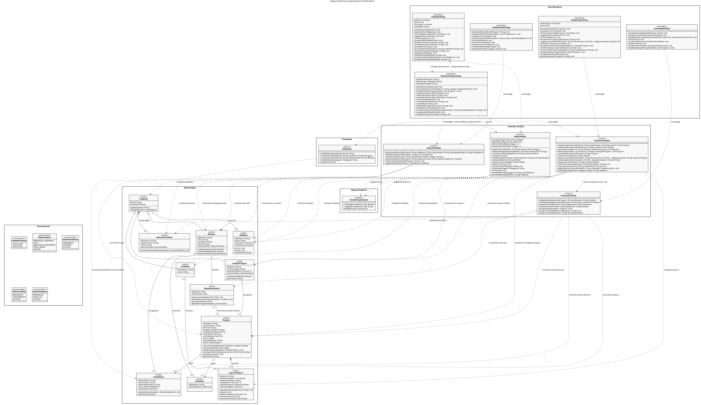

<i>Gambar 4.1. Diagram Kelas Perancangan Keseluruhan RekanBumi</i>

Gambar 4.1 disusun berlapis dari atas ke bawah, yaitu *View*, *Controller*, kelas pendukung dan integrasi eksternal, lalu *Model*, dengan garis mendatar dan tegak serta superkelas Pengguna di atas subkelasnya. Tipe enumerasi tidak digambar sebagai kotak tersendiri agar diagram tetap terbaca; daftarnya disajikan pada Tabel 4.3.

Tabel 4.1. Daftar Kelas Perancangan Keseluruhan

| ID Kelas | Nama Kelas | Atribut | Metode/Operasi |
| :--- | :--- | :--- | :--- |
| C01 | Program «entity» | `- idProgram: String` `- namaProgram: String` `- deskripsi: String` `- kategori: KategoriProgram` `- tempatPelaksanaan: String` `- waktuMulai: DateTime` `- waktuSelesai: DateTime` `- kuota: Integer` `- syaratKetentuan: String` `- status: StatusProgram` | `+ cekKuotaTersedia(jumlahTambahan: Integer): Boolean` `- hitungJumlahDiterima(): Integer` `+ ajukanKonfirmasi(): StatusProgram` `+ selesaikan(): StatusProgram` `+ mintaRevisi(): StatusProgram` `+ cekDalamWaktuPelaksanaan(waktu: DateTime): Boolean` `+ keteranganWaktu(): String` `+ hitungDurasiJam(): Float` `+ getTautan(): String` `+ ambilPengelola(): InisiatorProgram` `+ daftarPendaftar(): List<Pendaftaran>` `+ daftarRelawanDiterima(): List<Relawan>` `+ cari(kataKunci: String, kategori: KategoriProgram): List<Program> {static}` |
| C02 | Pendaftaran «entity» | `- idPendaftaran: String` `- keterampilan: String` `- ketersediaanWaktu: String` `- status: StatusPendaftaran` `- waktuDaftar: DateTime` | `+ terima(): void` `+ tolak(): void` `+ isDiterima(): Boolean` `+ sudahDiputuskan(): Boolean` |
| C03 | Relawan «entity» *turunan Pengguna* | `- idRelawan: String` `- nama: String` `- noTelepon: String` `- domisili: String` `- statusVerifikasi: StatusVerifikasi` | `+ cekKelengkapanData(): Boolean` `+ cekStatusKelayakan(): Boolean` `+ lihatPortofolio(): RiwayatKontribusi` `+ catatKontribusi(program: Program): Boolean` `- hadirPada(program: Program): Boolean` |
| C04 | Pengguna «entity» *(abstract)* | `# idPengguna: String` `# email: String` | `+ lihatNotifikasi(): List<Notifikasi>` |
| C05 | InisiatorProgram «entity» *turunan Pengguna* | `- idInisiator: String` `- namaLembaga: String` `- tautanSitusResmi: String [0..1]` `- statusVerifikasi: StatusVerifikasi` | `+ cekStatusVerifikasi(): Boolean` `+ getTautan(): String` |
| C06 | Verifikator «entity» *turunan Pengguna* | `- idVerifikator: String` `- nama: String` | `+ konfirmasiLaporan(laporan: LaporanProgram): void` `+ tolakLaporan(laporan: LaporanProgram, catatanRevisi: String): void` |
| C07 | DokumenVerifikasi «entity» | `- idDokumen: String` `- jenisDokumen: String` `- urlFile: String` `- statusVerifikasi: StatusVerifikasi` | - |
| C08 | Kehadiran «entity» | `- idKehadiran: String` `- waktuKehadiran: DateTime` | `+ untukProgram(program: Program): Boolean` |
| C09 | LaporanProgram «entity» | `- idLaporan: String` `- dokumentasiAkhir: List<String>` `- ringkasanCapaian: String` `- catatanRevisi: String [0..1]` `- statusPeninjauan: StatusPeninjauan` `- waktuPengajuan: DateTime` | `+ uploadDokumentasi(urlFile: String): void` `+ setujui(verifikator: Verifikator): void` `+ tolak(verifikator: Verifikator, catatanRevisi: String): void` `+ showSummary(): String` `+ showDokumentasi(): List<String>` |
| C10 | Notifikasi «entity» | `- idNotifikasi: String` `- pesan: String` `- waktuKirim: DateTime` `- statusDibaca: Boolean` | `+ kirim(): void` `+ baca(): void` `+ showDetail(): String` |
| C11 | RiwayatKontribusi «entity» | `- idRiwayat: String` `- totalJamAksi: Float` | `+ tambahRiwayatProgram(program: Program): void` `- perbaruiJamAksi(jamAksi: Float): void` `+ getTotalJamAksi(): Float` `+ getDaftarProgramSelesai(): List<Program>` |
| C12 | KelolaAkunPage «boundary» | `- dataDiri: FormData` `- berkas: File` `- formLogin: FormData` `- urlKembali: String` | `+ bukaHalamanRegistrasi(): void` `+ tampilkanFormRegistrasi(): void` `+ isiFormRegistrasi(dataDiri: FormData): void` `+ unggahDokumen(berkas: File): void` `+ kirimPendaftaran(): void` `+ tampilkanNotifikasiBerhasil(): void` `+ tampilkanPesanError(pesan: String): void` `+ arahkanKeLogin(urlKembali: String): void` `+ arahkanKembali(): void` `+ tampilkanFormLogin(): void` `+ terimaInputKredensial(email: String, kataSandi: String): void` `+ tampilkanPesanStatus(pesan: String): void` `+ bukaMenuNotifikasi(): void` `+ pilihNotifikasi(idNotifikasi: String): void` `+ tampilkanDaftarNotifikasi(daftar: List<Notifikasi>): void` `+ tampilkanDetailNotifikasi(detail: String): void` |
| C13 | AuthController «control» | `- percobaanGagal: Map<String, Integer>` `- waktuBlokir: Map<String, DateTime>` `- BATAS_PERCOBAAN: Integer = 5` `- DURASI_BLOKIR_MENIT: Integer = 5` | `+ buatAkunBaru(dataDiri: FormData, berkas: File): Pengguna` `- validasiKelengkapanData(dataDiri: FormData, berkas: File): String[]` `- cekStatusVerifikasi(dataDiri: FormData): StatusVerifikasi` `+ cekSesi(): Boolean` `+ validasiKredensial(email: String, kataSandi: String, ip: String): Boolean` `- cekStatusBlokir(ip: String): Boolean` `- catatPercobaanGagal(ip: String): Integer` `- blokirIP(ip: String): void` `- resetPercobaanGagal(ip: String): void` `- mulaiSesi(idPengguna: String): String` `+ ambilNotifikasi(idPengguna: String): List<Notifikasi>` `+ bacaNotifikasi(idNotifikasi: String): Notifikasi` |
| C14 | KelolaProgramPage «boundary» | `- dataProgram: FormData` `- berkas: File` | `+ bukaHalamanDaftarProgram(): void` `+ tampilkanFormProgram(): void` `+ isiFormProgram(dataProgram: FormData): void` `+ unggahDokumen(berkas: File): void` `+ kirimPendaftaran(): void` `+ tampilkanFormLaporan(idProgram: String): void` `+ unggahLaporanAkhir(idProgram: String, dokumentasi: List<File>, ringkasanCapaian: String): void` `+ pilihLaporan(idLaporan: String): void` `+ tampilkanLaporanUntukDitinjau(laporan: LaporanProgram): void` `+ kirimPersetujuanLaporan(idLaporan: String): void` `+ kirimPenolakanLaporan(idLaporan: String, catatanRevisi: String): void` `+ tampilkanStatusProgram(status: StatusProgram): void` `+ tampilkanNotifikasiBerhasil(): void` `+ tampilkanPesanError(pesan: String): void` |
| C15 | ProgramController «control» | - | `+ simpanProgramBaru(idInisiator: String, dataProgram: FormData, berkas: File): Program` `- validasiDataProgram(dataProgram: FormData, berkas: File): String[]` `+ cariProgram(kataKunci: String, kategori: KategoriProgram): List<Program>` `+ ambilDetailProgram(idProgram: String): Program` `- validasiTautanSitus(url: String): Boolean` `+ ajukanLaporanAkhir(idProgram: String, dokumentasi: List<File>, ringkasanCapaian: String): StatusProgram` `- validasiLaporan(dokumentasi: List<File>, ringkasanCapaian: String): String[]` `+ tinjauLaporan(idLaporan: String): LaporanProgram` `+ konfirmasiLaporan(idLaporan: String, idVerifikator: String): StatusProgram` `+ tolakLaporan(idLaporan: String, idVerifikator: String, catatanRevisi: String): StatusProgram` `- buatNotifikasi(penerima: Pengguna, pesan: String): Notifikasi` |
| C16 | EksplorasiProgramPage «boundary» | `- kataKunciPencarian: String` `- filterKategori: KategoriProgram` `- idProgramTerpilih: String` | `+ bukaHalamanEksplorasi(): void` `+ terimaInputPencarian(kataKunci: String, kategori: KategoriProgram): void` `+ tampilkanDaftarProgram(daftar: List<Program>): void` `+ tampilkanPesanTidakDitemukan(): void` `+ pilihProgram(idProgram: String): void` `+ tampilkanDetailProgram(idProgram: String): void` `+ klikTautanSitusResmi(): void` `+ arahkanKeSitusResmi(url: String): void` `+ nonaktifkanTautan(): void` `+ pilihDaftarProgram(idProgram: String): void` `+ tampilkanFormPendaftaran(): void` `+ kirimPermohonanPendaftaran(keterampilan: String, ketersediaanWaktu: String): void` `+ tampilkanNotifikasiBerhasil(): void` `+ tampilkanPesanError(pesan: String): void` |
| C17 | KelolaPendaftarPage «boundary» | - | `+ bukaKelolaPendaftar(idProgram: String): void` `+ tampilkanDaftarPendaftar(daftar: List<Pendaftaran>): void` `+ tampilkanFormSeleksi(): void` `+ pilihStatusSeleksi(idPendaftaran: String, status: StatusPendaftaran): void` `+ kirimHasilSeleksi(): void` `+ kirimKonfirmasiHasil(): void` `+ tampilkanKonfirmasiHasil(): void` `+ tampilkanNotifikasiBerhasil(): void` `+ tampilkanPesanError(pesan: String): void` |
| C18 | SeleksiController «control» | - | `+ ajukanPendaftaran(idProgram: String, idRelawan: String, keterampilan: String, ketersediaanWaktu: String): Pendaftaran` `+ lihatDaftarRelawan(idProgram: String): List<Pendaftaran>` `- validasiKuota(idProgram: String, jumlahDiterimaBaru: Integer): Boolean` `+ simpanHasilSeleksi(idProgram: String, keputusan: Map<String, StatusPendaftaran>): Boolean` `+ konfirmasiHasilSeleksi(idProgram: String): Boolean` `- triggerNotifikasi(pendaftaran: Pendaftaran): Notifikasi` |
| C19 | AreaKegiatanPage «boundary» | - | `+ bukaHalamanKegiatan(idProgram: String): void` `+ tampilkanTombolCheckIn(aktif: Boolean): void` `+ tampilkanKeteranganWaktu(keterangan: String): void` `+ klikCheckIn(): void` `+ tampilkanStatusCheckIn(berhasil: Boolean): void` `+ bukaPortofolio(): void` `+ tampilkanPortofolio(totalJamAksi: Float): void` `+ tampilkanRiwayatProgram(daftar: List<Program>): void` |
| C20 | PresensiController «control» | - | `+ validasiStatusRelawan(idProgram: String, idRelawan: String): Boolean` `+ validasiWaktuPelaksanaan(idProgram: String, waktu: DateTime): Boolean` `+ prosesCheckIn(idProgram: String, idRelawan: String): Kehadiran` `+ perbaruiPortofolioRelawan(idProgram: String): void` `+ ambilKeteranganWaktu(idProgram: String): String` `+ ambilTotalJamAksi(idRelawan: String): Float` `+ ambilRiwayatProgram(idRelawan: String): List<Program>` |
| C21 | CloudStorageAdapter «adapter» | - | `+ validasiBerkas(berkas: File): Boolean` `+ unggahBerkas(berkas: File): String` `+ ambilBerkas(url: String): File` |
| C22 | BetterAuth «library» | - | `+ daftarkanKredensial(email: String, kataSandi: String): String` `- hashKataSandi(kataSandi: String): String` `+ verifikasiKredensial(email: String, kataSandi: String): String` `- cocokkanHash(kataSandi: String, hashKataSandi: String): Boolean` `+ buatSesiMasuk(idPengguna: String): String` `+ ambilSesi(): String` |

## 4.2 Relasi Antarkelas

Tabel 4.2 merinci seluruh relasi pada Gambar 4.1. Generalisasi, asosiasi, agregasi, dan komposisi menggambarkan hubungan struktural antar-*entity* beserta multiplisitasnya, sedangkan dependensi menggambarkan pemanggilan dari *View* ke *Controller* dan dari *Controller* ke kelas lain. Bentuk relasi dipilih tidak lebih kuat dari maksudnya: komposisi dipakai apabila bagian tidak bermakna tanpa keseluruhannya (DokumenVerifikasi pada Pengguna, LaporanProgram pada Program, dan RiwayatKontribusi pada Relawan), agregasi dipakai apabila keseluruhan hanya mengelompokkan bagian yang tetap ada sendiri (RiwayatKontribusi mengelompokkan Program yang telah selesai diikuti), dan asosiasi biasa dipakai untuk hubungan lainnya, termasuk Pendaftaran dan Kehadiran yang menghubungkan dua objek sekaligus. Alasan setiap pilihan dicantumkan pada kolom Keterangan.

Tabel 4.2. Relasi Antarkelas

| No | Kelas Asal | Jenis Relasi | Kelas Tujuan | Multiplisitas | Keterangan |
| :--- | :--- | :--- | :--- | :--- | :--- |
| 1 | Relawan | Generalisasi | Pengguna | - | Relawan merupakan turunan dari Pengguna. |
| 2 | InisiatorProgram | Generalisasi | Pengguna | - | InisiatorProgram merupakan turunan dari Pengguna. |
| 3 | Verifikator | Generalisasi | Pengguna | - | Verifikator merupakan turunan dari Pengguna. |
| 4 | Pengguna | Komposisi | DokumenVerifikasi | 1 : 0..* | Pengguna mengunggah DokumenVerifikasi. Komposisi karena dokumen verifikasi tidak bermakna tanpa pengguna pemiliknya dan ikut terhapus bersama akunnya. |
| 5 | Pengguna | Asosiasi | Notifikasi | 1 : 0..* | Pengguna menerima Notifikasi. |
| 6 | InisiatorProgram | Asosiasi | Program | 1 : 0..* | InisiatorProgram mengelola Program. |
| 7 | Relawan | Asosiasi | Pendaftaran | 1 : 0..* | Relawan mengajukan Pendaftaran. Asosiasi biasa karena Pendaftaran menghubungkan dua objek (Relawan dan Program) sehingga tidak dimiliki oleh satu keseluruhan. |
| 8 | Program | Asosiasi | Pendaftaran | 1 : 0..* | Program untuk Pendaftaran. Multiplisitas 0..* dibatasi oleh aturan kuota (KF05) yang dijaga Program.cekKuotaTersedia(). |
| 9 | Relawan | Asosiasi | Kehadiran | 1 : 0..* | Relawan mencatat Kehadiran. Asosiasi biasa karena Kehadiran menghubungkan Relawan dan Program. |
| 10 | Program | Asosiasi | Kehadiran | 1 : 0..* | Program pada Kehadiran. |
| 11 | Relawan | Komposisi | RiwayatKontribusi | 1 : 1 | Relawan memiliki RiwayatKontribusi. Komposisi karena riwayat kontribusi hanya bermakna untuk relawan pemiliknya dan ikut terhapus bersama akunnya. |
| 12 | RiwayatKontribusi | Agregasi | Program | 0..* : 0..* | RiwayatKontribusi mengelompokkan Program. Agregasi karena riwayat kontribusi mengelompokkan program yang telah selesai diikuti, sedangkan Program tetap ada tanpa riwayat tersebut. |
| 13 | Program | Komposisi | LaporanProgram | 1 : 0..1 | Program memiliki LaporanProgram. Komposisi karena laporan akhir hanya bermakna untuk program yang dilaporkan dan ikut terhapus bersama programnya. |
| 14 | Verifikator | Asosiasi | LaporanProgram | 0..1 : 0..* | Verifikator meninjau LaporanProgram. |
| 15 | KelolaAkunPage | Dependensi | AuthController | - | Memanggil. |
| 16 | KelolaProgramPage | Dependensi | ProgramController | - | Memanggil. |
| 17 | EksplorasiProgramPage | Dependensi | ProgramController | - | Memanggil. |
| 18 | EksplorasiProgramPage | Dependensi | SeleksiController | - | Memanggil. |
| 19 | EksplorasiProgramPage | Dependensi | AuthController | - | Cek sesi. |
| 20 | KelolaPendaftarPage | Dependensi | SeleksiController | - | Memanggil. |
| 21 | AreaKegiatanPage | Dependensi | PresensiController | - | Memanggil. |
| 22 | EksplorasiProgramPage | Dependensi | KelolaAkunPage | - | Mengarahkan ke login. |
| 23 | AuthController | Dependensi | BetterAuth | - | Kelola kredensial & sesi. |
| 24 | AuthController | Dependensi | Relawan | - | Membuat akun relawan. |
| 25 | AuthController | Dependensi | InisiatorProgram | - | Membuat akun inisiator. |
| 26 | AuthController | Dependensi | DokumenVerifikasi | - | Membuat dokumen. |
| 27 | AuthController | Dependensi | Notifikasi | - | Mengambil notifikasi. |
| 28 | AuthController | Dependensi | CloudStorageAdapter | - | Unggah berkas. |
| 29 | ProgramController | Dependensi | Program | - | Membuat, mencari & mengubah status program. |
| 30 | ProgramController | Dependensi | DokumenVerifikasi | - | Membuat dokumen. |
| 31 | ProgramController | Dependensi | InisiatorProgram | - | Memeriksa status verifikasi. |
| 32 | ProgramController | Dependensi | LaporanProgram | - | Mengelola laporan. |
| 33 | ProgramController | Dependensi | Verifikator | - | Memproses peninjauan. |
| 34 | ProgramController | Dependensi | Notifikasi | - | Membuat notifikasi. |
| 35 | ProgramController | Dependensi | CloudStorageAdapter | - | Unggah/ambil berkas. |
| 36 | ProgramController | Dependensi | PresensiController | - | Memicu pembaruan jam aksi. |
| 37 | SeleksiController | Dependensi | Pendaftaran | - | Membuat pendaftaran & menetapkan hasil seleksi. |
| 38 | SeleksiController | Dependensi | Program | - | Memeriksa kuota & mengambil pendaftar. |
| 39 | SeleksiController | Dependensi | Relawan | - | Memeriksa kelengkapan data. |
| 40 | SeleksiController | Dependensi | Notifikasi | - | Membuat notifikasi. |
| 41 | PresensiController | Dependensi | Kehadiran | - | Mencatat kehadiran. |
| 42 | PresensiController | Dependensi | Pendaftaran | - | Memeriksa status diterima. |
| 43 | PresensiController | Dependensi | Program | - | Memeriksa waktu & mengambil relawan diterima. |
| 44 | PresensiController | Dependensi | RiwayatKontribusi | - | Mengambil ringkasan portofolio. |
| 45 | PresensiController | Dependensi | Relawan | - | Mencatat kontribusi & mengambil portofolio. |

## 4.3 Tipe Enumerasi

Tabel 4.3. Tipe Enumerasi

| Nama Enumerasi | Nilai | Keterangan |
| :--- | :--- | :--- |
| KategoriProgram | `JAGA_ALAM`, `JAGA_IKLIM` | Kategori program aksi (KF04). |
| StatusProgram | `MENUNGGU_VERIFIKASI`, `AKTIF`, `MENUNGGU_KONFIRMASI`, `PERLU_REVISI`, `SELESAI` | Status keberlangsungan program; MENUNGGU_KONFIRMASI dan SELESAI sesuai KF13–KF14, PERLU_REVISI sesuai skenario alternatif UC07. |
| StatusPendaftaran | `MENUNGGU`, `DITERIMA`, `DITOLAK` | Status seleksi pendaftaran relawan; DITERIMA/DITOLAK sesuai KF09. |
| StatusVerifikasi | `MENUNGGU`, `TERVERIFIKASI`, `DITOLAK` | Status verifikasi data Relawan, InisiatorProgram, dan DokumenVerifikasi. |
| StatusPeninjauan | `MENUNGGU`, `DISETUJUI`, `DITOLAK` | Status peninjauan LaporanProgram oleh Verifikator. |

## 4.4 Penyesuaian dari Kelas Analisis

Kelas perancangan merupakan penyempurnaan dari kelas analisis pada SKPL (subbab 5.2 dan 5.3 SKPL). Penyempurnaan mengikuti tiga aturan:
1. Nama dan ID kelas analisis dipertahankan (C01–C20).
2. **Nama operasi pada SKPL dipertahankan apabila ada padanannya**, termasuk ketika operasi tersebut dipindahkan ke kelas lain yang lebih tepat. Pengecualiannya adalah operasi *setter* status (`updateStatus()`, `perbaruiStatus()`, `updateStatusProgram()`), operasi yang membaca data objek lain untuk diputuskan di tempat lain (`getKataSandi()`, `cekKehadiran()`, `hitungJamAksi()` pada *controller*), serta operasi yang tidak dipakai *use case* mana pun. Operasi tersebut diganti atau dipindahkan ke objek pemilik informasinya sesuai gaya kendali didelegasikan.
3. Operasi baru hanya ditambahkan untuk langkah skenario *use case* yang belum memiliki operasi pada SKPL, sehingga setiap pesan pada *sequence diagram* memiliki operasi pada kelas tujuannya.

Dengan aturan tersebut, 67 dari 146 operasi pada BAB 4 memakai nama operasi SKPL. Penyesuaian per kelas dirangkum pada Tabel 4.4, sedangkan daftar operasi baru disajikan pada Tabel 4.5.

Tabel 4.4. Penyesuaian Kelas Analisis menjadi Kelas Perancangan

| ID Kelas | Nama Kelas | Penyesuaian | Alasan |
| :--- | :--- | :--- | :--- |
| C01 | Program | `waktuPelaksanaan`/`jadwal` diganti menjadi `waktuMulai` dan `waktuSelesai`; `lokasi` digabung ke `tempatPelaksanaan`; atribut `keterampilan`, `ketersediaanWaktu`, dan `tautanSitusResmi` dihapus; operasi *setter* `updateStatus()` dan `perbaruiStatus()` diganti operasi bermakna `ajukanKonfirmasi()`, `selesaikan()`, dan `mintaRevisi()`; `cekKuota()` digabung ke `cekKuotaTersedia()`; `showSummary()` dan `showDokumentasi()` dipindah ke LaporanProgram; operasi tampilan `getDetail()`, `getRingkasanProgram()`, `tampilkanDetail()`, dan `tampilkanRingkasan()` dihapus karena penampilan data dilakukan EksplorasiProgramPage; ditambah `cekDalamWaktuPelaksanaan()`, `hitungDurasiJam()`, `hitungJumlahDiterima()`, `keteranganWaktu()`, `ambilPengelola()`, `daftarPendaftar()`, `daftarRelawanDiterima()`, serta operasi statis `cari()` yang menggantikan `filterProgram()`. Operasi perubahan status mengembalikan status barunya agar dapat ditampilkan halaman. | Rentang waktu dibutuhkan untuk akses *check-in* (KF12) dan perhitungan jam aksi (KF15). Keterampilan dan ketersediaan waktu adalah data Pendaftaran; tautan situs resmi adalah data lembaga dan diakses melalui `getTautan()`. Program menjaga statusnya sendiri (gaya kendali didelegasikan) dan menjadi pemilik daftar pendaftarnya. |
| C02 | Pendaftaran | Ditambah `idPendaftaran` dan `waktuDaftar`; `daftar()` direalisasikan oleh `SeleksiController.ajukanPendaftaran()`; `triggerNotifikasi()` dipindah ke SeleksiController; `updateStatus()` diganti `terima()` dan `tolak()`; ditambah `isDiterima()` dan `sudahDiputuskan()`. | Pembuatan pendaftaran dan pengiriman notifikasi adalah alur proses yang menjadi tanggung jawab *Controller*, sedangkan status pendaftaran dijaga Pendaftaran sendiri. |
| C03 | Relawan | `totalJamAksi` dipindah ke RiwayatKontribusi; `lihatNotifikasi()` dipindah ke Pengguna; `cekStatusKelayakan()` dan `lihatPortofolio()` dipertahankan; ditambah `cekKelengkapanData()`, `catatKontribusi()`, dan `hadirPada()`; operasi profil yang tidak dipakai *use case* mana pun dihapus. | Menghindari penyimpanan jam aksi di dua tempat; pemeriksaan kelengkapan dan kelayakan dibutuhkan KF10; Relawan memeriksa kehadirannya sendiri saat jam aksi dicatat (KF15). |
| C04 | Pengguna | Atribut `kataSandi` dan operasi `getKataSandi()` dihapus karena kredensial disimpan dan diverifikasi oleh BetterAuth; ditambah `idPengguna`; `lihatNotifikasi()` dipindah dari Relawan; `tampilkanProfil()` dan `getEmail()` dihapus. | Menghilangkan kebergantungan BetterAuth ke Pengguna agar lapisan pendukung tidak bergantung ke atas (KNF02 tetap dipenuhi BetterAuth); seluruh jenis pengguna dapat menerima notifikasi. |
| C05 | InisiatorProgram | `simpanHasilSeleksi()` dan `konfirmasiHasilSeleksi()` dipindah ke SeleksiController; `uploadDokumentasi()` dipindah ke LaporanProgram; `lihatDaftarRelawan()` dipindah ke SeleksiController; `ubahStatusProgram()` dan `simpanStatus()` direalisasikan oleh `ProgramController.ajukanLaporanAkhir()`; `tampilkanProfilLembaga()` dihapus; ditambah `cekStatusVerifikasi()` dan `getTautan()`. | Aksi aktor direalisasikan melalui *Boundary* dan *Controller*; status verifikasi lembaga diperiksa saat mendaftarkan program. |
| C06 | Verifikator | Menjadi turunan Pengguna; ditambah `idVerifikator` dan `nama`; `konfirmasiLaporan()` dan `tolakLaporan()` dipertahankan dan meneruskan keputusan ke LaporanProgram yang ditinjaunya; `tinjauLaporan()` dipindah ke ProgramController; `konfirmasiPenyelesaianProgram()` digabung ke `konfirmasiLaporan()`. | Verifikator perlu masuk ke akun; keputusan persetujuan diambil Verifikator (gaya kendali didelegasikan), sedangkan ProgramController mengoordinasikan alurnya. |
| C07 | DokumenVerifikasi | Dimiliki oleh Pengguna (komposisi), bukan hanya Relawan; dibuat oleh AuthController (dokumen Relawan) dan ProgramController (dokumen legalitas lembaga); `perbaruiStatusVerifikasi()` tidak dimodelkan karena verifikasi dokumen oleh Verifikator berada di luar UC01–UC09. | KF01 menyatakan Inisiator juga mengunggah dokumen verifikasi. |
| C08 | Kehadiran | `cekKehadiran()` diganti `untukProgram()` yang dipanggil Relawan; `catatKehadiran()` direalisasikan oleh `PresensiController.prosesCheckIn()`; ditambah asosiasi ke Program. | Kehadiran selalu tercatat untuk satu relawan pada satu program. |
| C09 | LaporanProgram | `catatanCapaian` dan `ringkasanDampak` digabung menjadi `ringkasanCapaian`; ditambah `idLaporan`, `statusPeninjauan`, dan `waktuPengajuan`; menerima `uploadDokumentasi()`, `showSummary()`, dan `showDokumentasi()`; `setujui()` dan `tolak()` menerima Verifikator peninjau; `simpan()` tidak dimodelkan. | Satu atribut menyimpan ringkasan capaian dampak lingkungan dari Inisiator (KF16) yang dipublikasikan setelah disetujui. |
| C10 | Notifikasi | Ditambah `idNotifikasi`; `kirim()`, `baca()`, dan `showDetail()` dipertahankan; `buatNotifikasi()` dipindah ke ProgramController; penerima menjadi Pengguna. | Relawan, Inisiator, dan Verifikator sama-sama menerima notifikasi (UC06 dan UC07). |
| C11 | RiwayatKontribusi | `daftarProgramSelesai` menjadi agregasi ke Program; RiwayatKontribusi dimiliki Relawan melalui komposisi; `tambahRiwayatProgram()` dipertahankan dan menghitung jam aksi sendiri dari `Program.hitungDurasiJam()`, sedangkan `perbaruiJamAksi()` menjadi operasi privat; ditambah *getter* untuk tampilan portofolio. | Mendukung KF15 dan tampilan portofolio pada UC09. |
| C12 | KelolaAkunPage | Seluruh operasi SKPL dipertahankan; registrasi dipecah per langkah formulir; ditambah `urlKembali`, `arahkanKeLogin()`, `arahkanKembali()`, dan menu notifikasi akun. | Sesuai langkah skenario UC01, UC02 (kembali ke halaman program setelah *login*), dan UC06. |
| C13 | AuthController | `buatAkunBaru()`, `validasiKredensial()`, dan `mulaiSesi()` dipertahankan; `akhiriSesi()` dihapus karena tidak dipakai *use case* mana pun; `verifikasiKredensial()` dan `buatSesiMasuk()` dipindah ke BetterAuth; ditambah atribut dan operasi pemblokiran IP serta notifikasi akun. | Mendukung KNF06 (blokir IP 5 menit setelah 5 kali gagal) dan KF06 (wajib *login*). |
| C14 | KelolaProgramPage | Seluruh operasi SKPL dipertahankan; formulir program dipecah per langkah; ditambah antarmuka peninjauan laporan bagi Verifikator. | Inisiator melampirkan dokumen legalitas saat mendaftarkan program (KF01); UC07 dan UC09 dijalankan Verifikator melalui halaman kelola program. |
| C15 | ProgramController | `filterProgram()` digabung ke `Program.cari()` dan `updateStatusProgram()` diganti operasi status pada Program; `tinjauLaporan()` dan `konfirmasiLaporan()` dipindah dari Verifikator, `buatNotifikasi()` dari Notifikasi; ditambah `ajukanLaporanAkhir()`. | Mendukung KF13, KF14, dan KF16; `konfirmasiLaporan()` memicu `PresensiController.perbaruiPortofolioRelawan()` (KF15). |
| C16 | EksplorasiProgramPage | Seluruh operasi SKPL dipertahankan; ditambah pemilihan program, formulir permohonan pendaftaran, dan aksi klik tautan. | Relawan mendaftar program dari halaman detail program (UC01 dan UC02). |
| C17 | KelolaPendaftarPage | Seluruh operasi SKPL dipertahankan; ditambah aksi pemilihan status dan konfirmasi hasil. | Mendukung langkah skenario UC05 dan UC06. |
| C18 | SeleksiController | Seluruh operasi SKPL dipertahankan; `konfirmasiHasilSeleksi()` dan `lihatDaftarRelawan()` dipindah dari InisiatorProgram; ditambah `ajukanPendaftaran()`; `konfirmasiHasilSeleksi()` mengembalikan Boolean untuk skenario alternatif UC06. | Penerimaan permohonan pendaftaran (KF07, KF10) satu alur dengan proses seleksi. |
| C19 | AreaKegiatanPage | Seluruh operasi SKPL dipertahankan; ditambah aksi pengguna dan `tampilkanKeteranganWaktu()`. | Mendukung skenario alternatif UC08. |
| C20 | PresensiController | `cekKehadiran()` dan `hitungJamAksi()` diserahkan kepada Relawan dan RiwayatKontribusi; ditambah `ambilKeteranganWaktu()`, `ambilTotalJamAksi()`, dan `ambilRiwayatProgram()` yang hasilnya ditampilkan AreaKegiatanPage. | Gaya kendali didelegasikan: controller hanya mengoordinasikan pencatatan jam aksi (UC09). |
| C21 | CloudStorageAdapter | Kelas baru pada tahap perancangan. | Komponen integrasi eksternal pada APL yang dipanggil saat unggah dokumen (KF01, KNF03) dan dokumentasi laporan (KF13). |
| C22 | BetterAuth | Kelas baru pada tahap perancangan; menerima `verifikasiKredensial()` dan `buatSesiMasuk()` dari AuthController; ditambah `daftarkanKredensial()`; menyimpan dan memverifikasi kredensial tanpa membaca kelas Pengguna. | Komponen pendukung pada APL yang menjalankan *hashing* kata sandi (KNF02), verifikasi kredensial, dan sesi (KF06). |

Tabel 4.5. Operasi Baru pada Tahap Perancangan

| ID Kelas | Nama Kelas | Operasi Baru (tidak ada padanannya di SKPL) |
| :--- | :--- | :--- |
| C01 | Program | `hitungJumlahDiterima()`, `ajukanKonfirmasi()`, `selesaikan()`, `mintaRevisi()`, `cekDalamWaktuPelaksanaan()`, `keteranganWaktu()`, `hitungDurasiJam()`, `ambilPengelola()`, `daftarPendaftar()`, `daftarRelawanDiterima()`, `cari()` |
| C02 | Pendaftaran | `terima()`, `isDiterima()`, `sudahDiputuskan()` |
| C03 | Relawan | `cekKelengkapanData()`, `catatKontribusi()`, `hadirPada()` |
| C05 | InisiatorProgram | `cekStatusVerifikasi()` |
| C08 | Kehadiran | `untukProgram()` |
| C11 | RiwayatKontribusi | `getTotalJamAksi()`, `getDaftarProgramSelesai()` |
| C12 | KelolaAkunPage | `bukaHalamanRegistrasi()`, `isiFormRegistrasi()`, `unggahDokumen()`, `kirimPendaftaran()`, `tampilkanNotifikasiBerhasil()`, `arahkanKeLogin()`, `arahkanKembali()`, `bukaMenuNotifikasi()`, `pilihNotifikasi()`, `tampilkanDaftarNotifikasi()`, `tampilkanDetailNotifikasi()` |
| C13 | AuthController | `validasiKelengkapanData()`, `cekStatusVerifikasi()`, `cekSesi()`, `cekStatusBlokir()`, `catatPercobaanGagal()`, `blokirIP()`, `resetPercobaanGagal()`, `ambilNotifikasi()`, `bacaNotifikasi()` |
| C14 | KelolaProgramPage | `bukaHalamanDaftarProgram()`, `isiFormProgram()`, `unggahDokumen()`, `kirimPendaftaran()`, `pilihLaporan()`, `tampilkanLaporanUntukDitinjau()`, `kirimPersetujuanLaporan()`, `kirimPenolakanLaporan()`, `tampilkanNotifikasiBerhasil()` |
| C15 | ProgramController | `ajukanLaporanAkhir()` |
| C16 | EksplorasiProgramPage | `bukaHalamanEksplorasi()`, `tampilkanPesanTidakDitemukan()`, `pilihProgram()`, `klikTautanSitusResmi()`, `pilihDaftarProgram()`, `tampilkanFormPendaftaran()`, `kirimPermohonanPendaftaran()`, `tampilkanNotifikasiBerhasil()` |
| C17 | KelolaPendaftarPage | `bukaKelolaPendaftar()`, `pilihStatusSeleksi()`, `kirimHasilSeleksi()`, `kirimKonfirmasiHasil()`, `tampilkanNotifikasiBerhasil()` |
| C18 | SeleksiController | `ajukanPendaftaran()` |
| C19 | AreaKegiatanPage | `bukaHalamanKegiatan()`, `tampilkanKeteranganWaktu()`, `klikCheckIn()`, `bukaPortofolio()` |
| C20 | PresensiController | `ambilKeteranganWaktu()`, `ambilTotalJamAksi()`, `ambilRiwayatProgram()` |
| C21 | CloudStorageAdapter | `validasiBerkas()`, `unggahBerkas()`, `ambilBerkas()` |
| C22 | BetterAuth | `daftarkanKredensial()`, `hashKataSandi()`, `cocokkanHash()`, `ambilSesi()` |

 

---

# BAB 5: Matriks Kerunutan

Matriks kerunutan berikut memetakan setiap kelas perancangan pada BAB 4 terhadap *use case* yang direalisasikannya. Suatu kelas dinyatakan terkait dengan suatu *use case* apabila objek kelas tersebut terlibat pada *sequence diagram* skenario normal atau alternatif *use case* tersebut. Pemetaan ini merupakan pembaruan dari BAB 6 *Traceability* pada SKPL (revisi D) yang disesuaikan dengan realisasi *use case* pada tahap perancangan.

Tabel 5.1. Matriks Kerunutan Kelas terhadap Use Case

| Kelas | Use Case Terkait |
| :--- | :--- |
| C01 - Program | UC01 - Daftar program; UC03 - Mencari program; UC04 - Mengunjungi situs program; UC05 - Menyeleksi calon relawan pendaftar; UC06 - Konfirmasi status pendaftaran; UC07 - Memperbarui status program; UC08 - Konfirmasi kehadiran program; UC09 - Memperbarui status akun relawan |
| C02 - Pendaftaran | UC01 - Daftar program; UC05 - Menyeleksi calon relawan pendaftar; UC06 - Konfirmasi status pendaftaran; UC08 - Konfirmasi kehadiran program; UC09 - Memperbarui status akun relawan |
| C03 - Relawan | UC01 - Daftar program; UC06 - Konfirmasi status pendaftaran; UC09 - Memperbarui status akun relawan |
| C04 - Pengguna | UC01 - Daftar program; UC06 - Konfirmasi status pendaftaran |
| C05 - InisiatorProgram | UC01 - Daftar program; UC04 - Mengunjungi situs program |
| C06 - Verifikator | UC07 - Memperbarui status program |
| C07 - DokumenVerifikasi | UC01 - Daftar program |
| C08 - Kehadiran | UC08 - Konfirmasi kehadiran program; UC09 - Memperbarui status akun relawan |
| C09 - LaporanProgram | UC07 - Memperbarui status program |
| C10 - Notifikasi | UC06 - Konfirmasi status pendaftaran; UC07 - Memperbarui status program |
| C11 - RiwayatKontribusi | UC09 - Memperbarui status akun relawan |
| C12 - KelolaAkunPage | UC01 - Daftar program; UC02 - Login akun; UC06 - Konfirmasi status pendaftaran |
| C13 - AuthController | UC01 - Daftar program; UC02 - Login akun; UC06 - Konfirmasi status pendaftaran |
| C14 - KelolaProgramPage | UC01 - Daftar program; UC07 - Memperbarui status program; UC09 - Memperbarui status akun relawan |
| C15 - ProgramController | UC01 - Daftar program; UC03 - Mencari program; UC04 - Mengunjungi situs program; UC07 - Memperbarui status program; UC09 - Memperbarui status akun relawan |
| C16 - EksplorasiProgramPage | UC01 - Daftar program; UC02 - Login akun; UC03 - Mencari program; UC04 - Mengunjungi situs program |
| C17 - KelolaPendaftarPage | UC05 - Menyeleksi calon relawan pendaftar; UC06 - Konfirmasi status pendaftaran |
| C18 - SeleksiController | UC01 - Daftar program; UC05 - Menyeleksi calon relawan pendaftar; UC06 - Konfirmasi status pendaftaran |
| C19 - AreaKegiatanPage | UC08 - Konfirmasi kehadiran program; UC09 - Memperbarui status akun relawan |
| C20 - PresensiController | UC07 - Memperbarui status program; UC08 - Konfirmasi kehadiran program; UC09 - Memperbarui status akun relawan |
| C21 - CloudStorageAdapter | UC01 - Daftar program; UC07 - Memperbarui status program |
| C22 - BetterAuth | UC01 - Daftar program; UC02 - Login akun |
