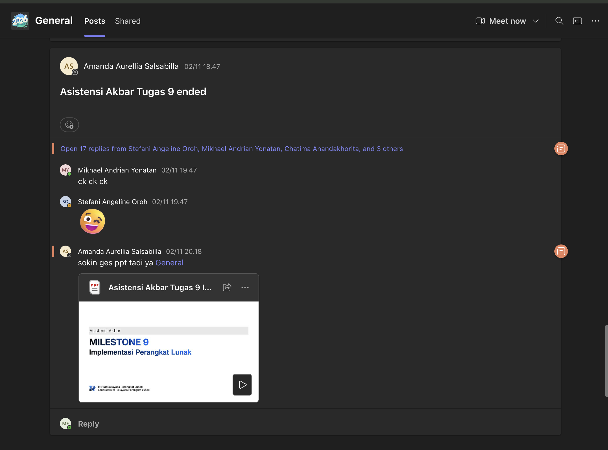

# Form Asistensi

## Tugas Besar IF2150 - Rekayasa Perangkat Lunak

| Informasi | Keterangan |
| --- | --- |
| **Hari** | Senin |
| **Tanggal** | 02/11/2026 |
| **Kelas** | K03 |
| **Nomor Kelompok** | G01 |
| **Nama Kelompok** | rplsukses |
| **Nama Perangkat Lunak** | RekanBumi |
| **Dokumen** | M9 (Implementasi Perangkat Lunak) |

### Anggota Kelompok

| NIM | Nama |
| --- | --- |
| 13525018 | Avicenna Ananda Musthafa |
| 13525045 | Ribka Kaylena Sanjaya |
| 13525063 | Kairenzo Vemil |
| 13525069 | Mulky Siraj Firizqi |
| 13525144 | Three Gie Gendhis Sekar Ayoe Jatmiko |

### Catatan

| Catatan |
| --- |
| 1. Asistensi dilakukan secara daring dalam bentuk asistensi akbar Milestone 9 (Implementasi Perangkat Lunak), diikuti seluruh anggota kelompok. |
| 2. Deadline pengumpulan dan teknis pengumpulan: release tag (`v9.0`) pada repository GitHub yang bersifat public. |
| 3. Pola arsitektur pada DPPL (misalnya MVC atau layered) harus terlihat pada struktur kode; implementasi boleh berupa fungsi, komponen, atau route selama setiap kelas DPPL dapat ditelusuri (B.5). |
| 4. Laporan memuat B.1 perubahan dari DPPL, B.2 bukti best practices dan profiling minimal satu fitur berat, B.3 kendala, B.4 kontribusi anggota, dan B.5 traceability kelas ke implementasi. |
| 5. Seluruh kode berada di folder `src/` beserta README yang memuat deskripsi, teknologi dan versi, prasyarat dan instalasi, konfigurasi, cara menjalankan, akun atau data uji, daftar modul dan pembagian tugas, serta tabel atau skema basis data. |
| 6. Dependensi dikelola lewat file standar dan folder hasil instalasi tidak boleh di-commit. Basis data disarankan dapat dijalankan lokal (SQLite atau PostgreSQL melalui Docker Compose). |
| 7. Alur Git: branch fitur dibuat dari `develop`, di-pull dari `develop` sebelum PR, di-review, lalu di-merge setelah approved. Commit memakai format semantic commit `<tipe>(<scope>): <deskripsi>`. |

## Dokumentasi

<!--  -->

  

  <i>Gambar 1. Dokumentasi asistensi akbar Milestone 9 (Microsoft Teams).</i>

